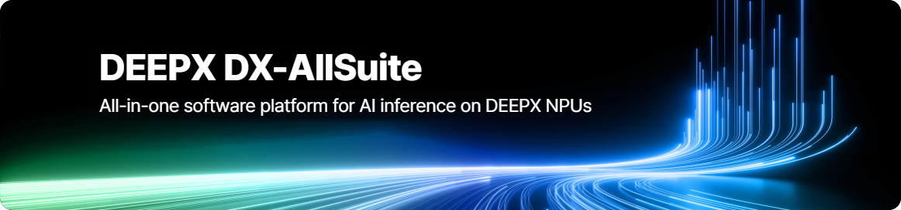
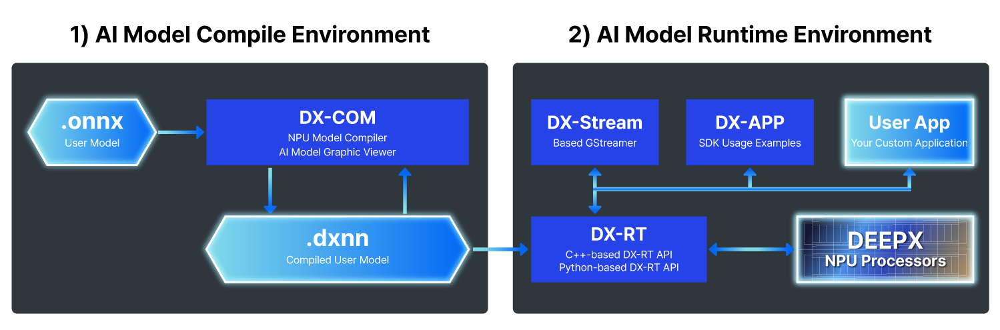
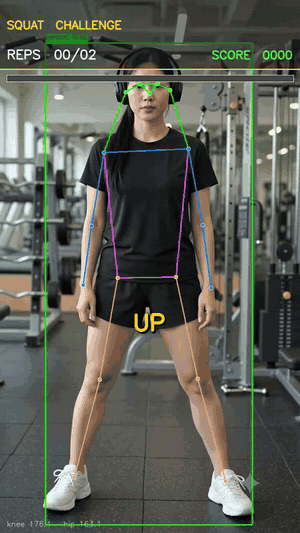
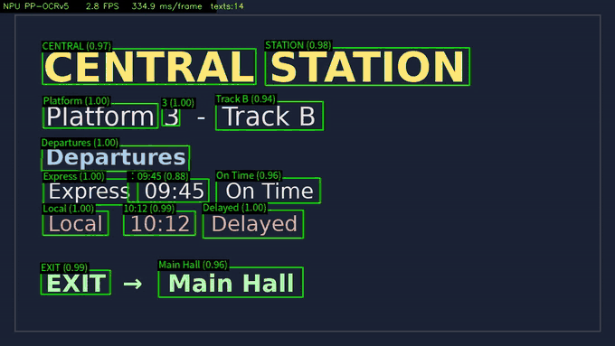

# DX-AllSuite

<div align="center">



**From AI Models to Edge AI Products.**

[](https://github.com/DEEPX-AI/dx-all-suite/releases)
[](https://developer.deepx.ai/tech-docs/)


</div>

<div align="center">
  <picture>
    <source media="(prefers-color-scheme: dark)" srcset="./img/DXNN-SDK-Simple-Architecture-dark.png">
    
  </picture>
</div>

DX-AllSuite combines the **DXNN® SDK** into one version-aligned environment for model optimization,
app development and edge deployment on DEEPX NPUs:

**Model** (ONNX from PyTorch, TensorFlow, … or DX-ModelZoo) → **Optimize** (DX-COM) → **Build & Run** (DX-RT, DX-STREAM, DX-APP) → **Deploy** (edge devices, optionally via DX-Edge)

- **Compile once, run on x86_64 or aarch64** — the same `.dxnn` file runs on a PC or an Arm board with a DEEPX NPU.
- **Benchmarked on real hardware** — reproducible YOLO26 results across multiple host + NPU combinations → [DX-Benchmark Dashboard](https://deepx-ai.github.io/dx-all-suite/dx-benchmark/)
- **Fits your existing stack** — Python and C++ APIs, `format=deepx` export from Ultralytics YOLO, PaddleOCR support, containers, and Kubernetes.

## What You Need

You need two roles. **They can be the same x86_64 machine** if it has a DEEPX NPU installed.

| | Host — compiles models | Target — runs models |
|---|---|---|
| **Arch** | x86_64 | x86_64, aarch64 |
| **OS** | Ubuntu 20.04 / 22.04 / 24.04 / 26.04 LTS, Fedora 42–45, RHEL 9–10, CentOS Stream 9–10 | Ubuntu 20.04 / 22.04 / 24.04 / 26.04 LTS, Debian 12 / 13 |
| **Python** | 3.8–3.14 | 3.8–3.14 |
| **Hardware** | Any x86_64 PC (CUDA GPU optional: speeds up quantization, required for Q-Master) | A DEEPX NPU — DX-M1, DX-M1M or DX-H1 Quattro |

Windows 10 22H2 or later (x64) is supported by DX-RT, DX-APP and DX-STREAM. See each component's README.

## Quick Start

Run a pre-compiled model on your NPU in a few commands — no compiler and no clone needed. Run these on the target:

```bash
# Install the NPU driver, firmware and DX-RT, then reboot to load the driver
curl -fsSL https://raw.githubusercontent.com/DEEPX-AI/dx-runtime/main/oneline-install.sh | sh
sudo reboot

# Check the NPU, download ResNet-50 from DX-ModelZoo, and run it (prints latency and FPS)
dxcli -s
curl -fLO https://sdk.deepx.ai/modelzoo/q-lite-dxnn/latest/resnet50_224x224.dxnn
dxrun -m resnet50_224x224.dxnn -l 100
```

## Full Workflow: Compile and Run the Samples

This compiles three sample models (face detection, object detection, classification) on the host and
runs them on the target. Commands that need root use `sudo` and may ask for your password.

**1. On the host — install the compiler and compile the samples**

```bash
git clone --recurse-submodules https://github.com/DEEPX-AI/dx-all-suite.git
cd dx-all-suite

# Install DX-COM, download sample models and calibration images, then compile
./getting-started/compiler-0_install_dx-compiler.sh
./getting-started/compiler-1_download_onnx.sh
./getting-started/compiler-2_setup_calibration_dataset.sh
./getting-started/compiler-3_setup_output_path.sh
./getting-started/compiler-4_model_compile.sh    # output: getting-started/dxnn/*.dxnn
```

**2. Different target machine? Copy the compiled models over** (skip if host and target are the same)

```bash
# on the target
git clone --recurse-submodules https://github.com/DEEPX-AI/dx-all-suite.git
mkdir -p dx-all-suite/workspace/dxnn

# on the host
scp getting-started/dxnn/*.dxnn <user>@<target>:~/dx-all-suite/workspace/dxnn/
```

**3. On the target — install the runtime and run**

```bash
# Install the NPU driver, firmware and DX-RT, then reboot once to load the driver
cd dx-all-suite
./getting-started/runtime-0_install_dx-runtime.sh
sudo reboot

# After the reboot: check the NPU, link the models, fetch assets, run the samples
cd dx-all-suite
dxcli -s
./getting-started/runtime-1_setup_input_path.sh
./getting-started/runtime-2_setup_assets.sh
./getting-started/runtime-3_run_example_using_dxrt.sh
```

The last script prints the average **FPS** and **latency** for each model and saves result images.
<!-- TODO: add a trimmed real terminal output and one result image here -->

Step-by-step explanation and troubleshooting → [Running Your First NPU Model](https://developer.deepx.ai/tech-docs/DX-AllSuite/Running_Your_First_NPU_Model/)

<details>
<summary><b>Other Ways to Install: one-line compiler install, version pinning, APT, uninstall</b></summary>

Install the compiler without cloning the repository (no sample data included):

```bash
# Host: DX-COM into ~/deepx/venv-dx-compiler, `dxcom` linked into ~/.local/bin
curl -fsSL https://raw.githubusercontent.com/DEEPX-AI/dx-compiler/main/oneline-install.sh | sh
```

Pin a version:

```bash
curl -fsSL https://raw.githubusercontent.com/DEEPX-AI/dx-compiler/main/oneline-install.sh \
  | DX_VERSION=<version> sh    # e.g. a tag from Releases
```

The runtime installer takes `DX_RT_VERSION`, `DX_DRIVER_VERSION` and `DX_FW_VERSION` the same way.

Uninstall by running `oneline-uninstall.sh` from the same URLs. Firmware already flashed to the NPU
and the `dx_engine` Python wheel are not removed.

DX-Runtime is also published as an APT repository, so later releases arrive with
`sudo apt update && sudo apt upgrade`. Setup steps → [Setting Up Environment](https://developer.deepx.ai/tech-docs/DX-AllSuite/Setting_Up_Environment/)

</details>

## Compile and Run Your Own Model

**Compile** (host). Write a config describing the input and the calibration images, then run `dxcom`:

```json
{
  "inputs": {"images": [1, 3, 640, 640]},
  "calibration_method": "ema",
  "calibration_num": 100,
  "default_loader": {
    "dataset_path": "./calibration_dataset",
    "file_extensions": ["jpeg", "png", "jpg"],
    "preprocessings": [
      {"resize": {"width": 640, "height": 640}},
      {"div": {"x": 255}},
      {"convertColor": {"form": "BGR2RGB"}},
      {"transpose": {"axis": [2, 0, 1]}},
      {"expandDim": {"axis": 0}}
    ]
  }
}
```

```bash
dxcom -m model.onnx -c config.json -o output/      # → output/model.dxnn
```

The `inputs` key must match your ONNX input name, and the preprocessing must match how the model was
trained. DX-COM offers three quantization levels — **Q-Lite**, **Q-Pro** and **Q-Master** — to trade
compile time for accuracy. The CLI handles single-input models; use the Python API (`dx_com.compile()`) for multi-input models.
Config fields and options: see the `dx-compiler` repository (linked in the table below).

Using Ultralytics YOLO? Skip the config: `yolo export model=yolo26n.pt format=deepx`.

**Run** (target). Benchmark from the command line:

```bash
dxrun -m model.dxnn -l 100       # 100 inference loops, prints latency and FPS
```

Or call it from Python:

```python
import numpy as np
from dx_engine import InferenceEngine, InferenceOption

engine = InferenceEngine("model.dxnn", InferenceOption())
input_tensor = np.zeros(engine.get_input_size(), dtype=np.uint8)   # replace with your preprocessed image
outputs = engine.run([input_tensor])
for i, out in enumerate(outputs):
    print(i, out.shape, out.dtype)
```

The runtime stages the `dx_engine` wheels in `/usr/share/libdxrt-bin/python/` but does not install them.
Install the one for your Python first, preferably in a virtualenv:

```bash
pip install /usr/share/libdxrt-bin/python/dx_engine-*-cp$(python3 -c 'import sys;print(f"{sys.version_info[0]}{sys.version_info[1]}")')-*.whl
```

C++ API and more examples → [`dx_rt`](https://github.com/DEEPX-AI/dx_rt)

## What's in the Suite

| Component | What it does | Runs on | Source |
|---|---|---|---|
| **DX-Compiler** (DX-COM) | Compiles ONNX models into NPU-ready `.dxnn` files (`dxcom`, INT8 quantization) | Host | [`dx-compiler`](https://github.com/DEEPX-AI/dx-compiler) |
| **DX-Runtime** | Target-side bundle with one installer for the five components below | Target | [`dx-runtime`](https://github.com/DEEPX-AI/dx-runtime) |
| ↳ DX-RT | Runs `.dxnn` models from C++ or Python; `dxrun` and `dxcli` tools | Target | [`dx_rt`](https://github.com/DEEPX-AI/dx_rt) |
| ↳ DX-APP | Ready-to-run C++ and Python AI applications | Target | [`dx_app`](https://github.com/DEEPX-AI/dx_app) |
| ↳ DX-STREAM | GStreamer elements for building Vision AI pipelines | Target | [`dx_stream`](https://github.com/DEEPX-AI/dx_stream) |
| ↳ NPU Driver · DX-FW | Linux kernel driver and NPU firmware | Target | [`dx_rt_npu_linux_driver`](https://github.com/DEEPX-AI/dx_rt_npu_linux_driver) · [`dx_fw`](https://github.com/DEEPX-AI/dx_fw) |
| **DX-ModelZoo** | Pre-compiled models and the `dxmz` evaluation tool | Host / Target | [`dx-modelzoo`](https://github.com/DEEPX-AI/dx-modelzoo) |
| **DX K8s Device Plugin** | Exposes NPUs to Kubernetes as `deepx.ai/dx-m1` | Cluster | [`dx-k8s-device-plugin`](https://github.com/DEEPX-AI/dx-k8s-device-plugin) |

**DX-APP or DX-STREAM?** Use DX-APP to write your own C++ or Python application. Use DX-STREAM to build
GStreamer pipelines for video streams, multi-channel input, tracking or messaging.

Which component versions ship together in each release → [Version Compatibility](https://developer.deepx.ai/tech-docs/DX-AllSuite/Version_Compatibility/)

## Containers & Kubernetes

```bash
docker run --rm -it --privileged --ipc=host --pid=host --network=host -v /dev:/dev \
    --entrypoint bash ghcr.io/deepx-ai/dx-runtime:latest
```

`--privileged` and `-v /dev:/dev` give the container access to the NPU device.
Images: `dx-runtime` (variants `rt`, `rt-app`, `rt-stream`, `rt-app-stream`; amd64 and arm64), `dx-compiler` and `dx-modelzoo` (amd64).
Tags and device passthrough options → [Docker Guide](./docker/README.md)

On Kubernetes, the device plugin exposes DX-M1 NPUs as the resource `deepx.ai/dx-m1`, so a pod requests one like CPU or memory: `resources.limits: {deepx.ai/dx-m1: 1}`.
→ [Kubernetes Quickstart](https://developer.deepx.ai/tech-docs/DX-AllSuite/Kubernetes_Quickstart/) · [Beginner Guide](https://developer.deepx.ai/tech-docs/DX-AllSuite/Kubernetes_Beginner_Guide/)

## Tools & Solutions

<table>
<tr>
 <td align="center"><a href="./dx-agent-dev-showcase/mini-game-squat-fitness/README.md"></a><br><sub>Pose-based squat game: built from one prompt</sub></td>
 <td align="center"><a href="./dx-agent-dev-showcase/paddleocr-video-ocr/README.md"></a><br><sub>Real-time video OCR (PP-OCRv5) on DX-M1</sub></td>
</tr>
</table>

More examples → [Showcases](./dx-agent-dev-showcase/README.md)

| Tool | What it does | |
|---|---|---|
| **DX-Agent-Driven Development - dx-agent-dev (Beta)** | Describe an NPU app in plain language; an AI coding agent (Claude Code, Cursor, Copilot, OpenCode, Codex CLI) builds and validates it, using DEEPX-specific rules and skills for DX-RT and DX-STREAM | [Docs](https://developer.deepx.ai/tech-docs/DX-AllSuite/Agent_Driven_Development/) · [Showcases](./dx-agent-dev-showcase/README.md) |
| **DX-AI-Studio (Beta)** | A visual workspace — DX-ModelZoo, DX-COM, DX-STREAM, DX-APP, Monitor and more — to explore models, compile, run inference and monitor the NPU without the CLI | [Overview](./dx-ai-studio/README.md) · [Install](https://developer.deepx.ai/tech-docs/DX-AllSuite/ai-studio/Installation_and_Launch/) |
| **DX-Benchmark (Beta)** | Reproducible YOLO26 benchmarks, model-level and end-to-end, with an interactive dashboard | [Get Started](./dx-benchmark/README.md) |
| **DX-Edge** | Compile ONNX to `.dxnn` on AWS, and provision the driver, firmware, DX-RT and DX-STREAM over the air with AWS IoT Greengrass (AWS Marketplace) | [Explore](./dx-edge/README.md) |

## Supported Models

Classification, object detection (YOLO family from v3 to the latest, YOLOX, RT-DETR, SSD, …), segmentation, pose,
face analysis, OCR, depth estimation, super resolution and more.
Download pre-compiled, benchmarked `.dxnn` files with published accuracy and performance from **[DX-ModelZoo](https://developer.deepx.ai/modelzoo/)**.

## Documentation & Support

- Guides, API reference and FAQ: **[developer.deepx.ai/tech-docs](https://developer.deepx.ai/tech-docs/)** · [Release Notes](./RELEASE_NOTES.md)
- For technical questions, please ask in the DEEPX Developer Community: https://community.deepx.ai/c/support/5

## License

DX-AllSuite is proprietary software provided to customers using DEEPX NPUs. See [LICENSE](./LICENSE) for terms of use.

Copyright © DEEPX Co., Ltd.
