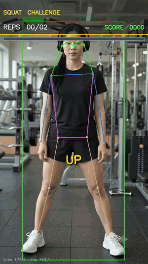
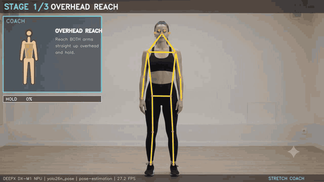
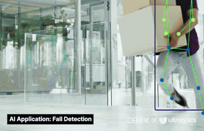
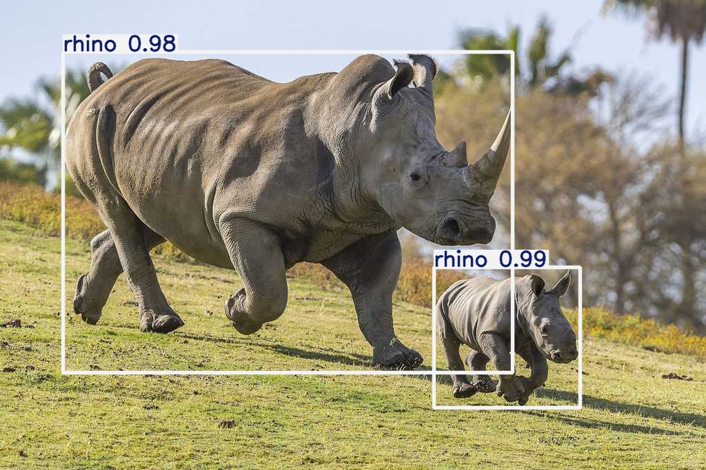
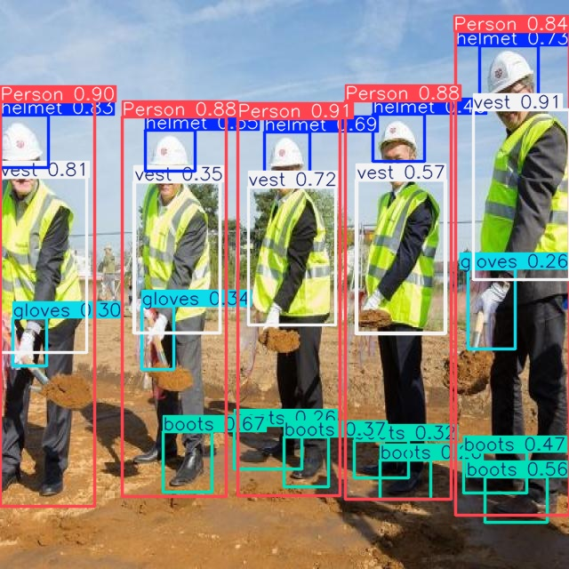
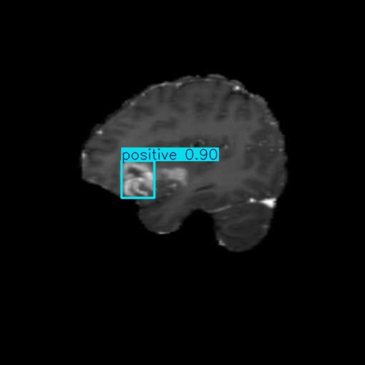
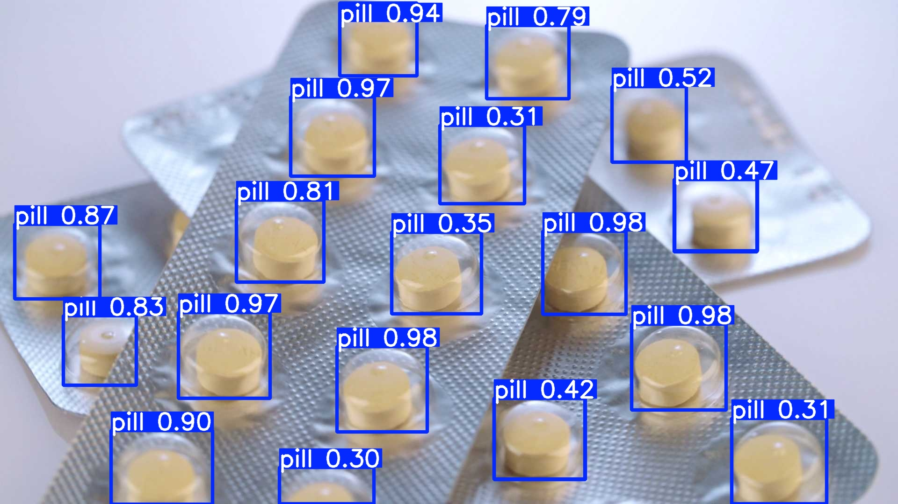
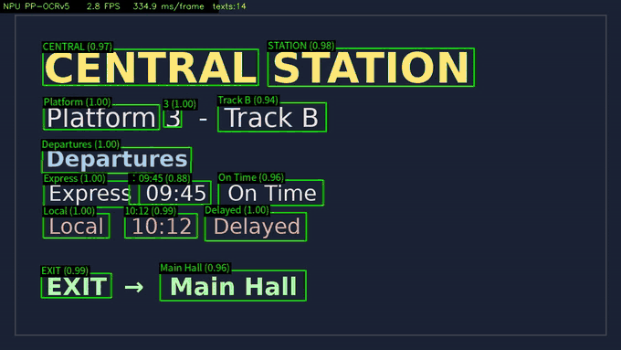
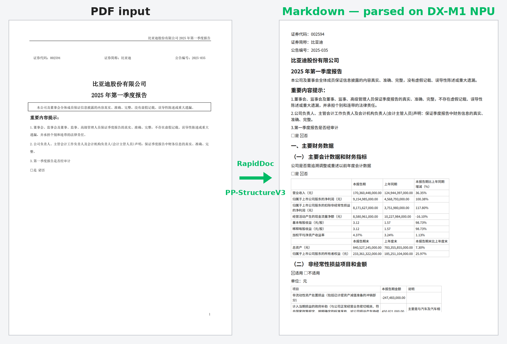

<div align="center">

# DX-Agent-Driven Development Showcases (Beta)

**Describe an NPU app in plain language. An AI coding agent builds, tests and runs it on a DEEPX NPU.**

[](https://developer.deepx.ai/tech-docs/DX-AllSuite/Agent_Driven_Development/)


</div>

Every app below was built by an AI coding agent from a **single prompt** with **DX-Agent-Driven Development - dx-agent-dev (Beta)**.
Each one is checked in with the prompt, measured results, a one-command reproduce and the full
build-session transcript, so you can see exactly how it was made.

## What You Need

| | |
|---|---|
| **NPU** | A DEEPX NPU with DX-RT installed ([Quick Start](../README.md#quick-start)) |
| **DX-COM** | Only if your prompt compiles a model |
| **AI coding agent** | Claude Code, GitHub Copilot (VS Code), Cursor, OpenCode or Codex CLI |

## Quick Start

No extra setup — the agent loads the DEEPX knowledge base from the repository automatically.

```bash
git clone --recurse-submodules https://github.com/DEEPX-AI/dx-all-suite.git
cd dx-all-suite
claude            # or: opencode · cursor-agent · ~/bin/codex · code .  (GitHub Copilot)
```

Then describe what you want:

```text
Compile yolo26n.onnx to DXNN and build a person detection Python app with it
```

In GitHub Copilot Chat or OpenCode, start the prompt with `@dx-suite-builder`. The agent works through
brainstorm → plan → TDD → verify and writes its output to a new session directory — it does not modify existing source.
Per-tool usage and more example prompts → [DX-Agent-Driven Development Docs](https://developer.deepx.ai/tech-docs/DX-AllSuite/Agent_Driven_Development/)

<!-- catalog -->
<!-- dx-showcase:docs:catalog:start -->
## NPU-powered AI apps (mini-games)

**Build a fully autonomous DEEPX-NPU app from natural language — in ~20 minutes, for ~$10.** Pose-driven mini-games with arcade HUDs, built end to end from a single prompt.

| Showcase | Kind | Highlight |
|---|---|---|
| [Squat-Counting Mini-Game](./mini-game-squat-fitness/README.md) | game | pose game + arcade HUD |
| [Stretching Coach Mini-Game](./mini-game-stretching-coach/README.md) | game | coach avatar + 3 stages |

### Squat-Counting Mini-Game

<a href="./mini-game-squat-fitness/README.md"></a>

Counts squat reps from knee/hip angles with an arcade HUD (reps / score / DOWN·UP·GOOD!).

**Highlight:** pose game + arcade HUD · **Claude Opus 4.8** · ≈ 12 min · ≈ $7.3 — [details →](./mini-game-squat-fitness/README.md)

<br clear="right">

### Stretching Coach Mini-Game

<a href="./mini-game-stretching-coach/README.md"></a>

Guides 3 stretches with an animated coach avatar that demonstrates each target pose.

**Highlight:** coach avatar + 3 stages · **Claude Opus 4.8** · ≈ 15 min · ≈ $8.1 — [details →](./mini-game-stretching-coach/README.md)

<br clear="right">

## Ultralytics ecosystem integration

**Take any Ultralytics YOLO to the DEEPX NPU in one command — or retrain it for your domain — all in natural language.** `format=deepx` export + 4-way eval (base/retrained × fp32-GPU / INT8-NPU); INT8 ≈ fp32, and the domain model runs faster on the NPU.

| Showcase | Kind | Highlight |
|---|---|---|
| [Ultralytics YOLO → DeepX Export](./ultralytics-yolo-deepx-export/README.md) | export | 1-cmd .pt → .dxnn |
| [African Wildlife Monitoring](./ultralytics-retrain-eval-deepx-export-wildlife/README.md) | retrain | mAP ~0.0007→0.79, 59→80 FPS |
| [Construction PPE Safety](./ultralytics-retrain-eval-deepx-export-ppe/README.md) | retrain | mAP 0.0001→0.257, 58→80 FPS |
| [Brain-Tumor Screening](./ultralytics-retrain-eval-deepx-export-braintumor/README.md) | retrain | mAP ~0.0005→0.40, 59→83 FPS |
| [Pharmaceutical Pill Inspection](./ultralytics-retrain-eval-deepx-export-pills/README.md) | retrain | mAP ~0.001→0.75 (mAP50 0.97), 55→78 FPS |

### Ultralytics YOLO → DeepX Export

<a href="./ultralytics-yolo-deepx-export/README.md"></a>

Turns an Ultralytics YOLO `.pt` into a deployable DeepX NPU model (`.dxnn`) in a single `yolo export ... format=deepx` command, then runs NPU inference + verify.

**Highlight:** 1-cmd .pt → .dxnn · **Claude Sonnet 4.6** · ≈ 12 min · ≈ $2.4 — [details →](./ultralytics-yolo-deepx-export/README.md)

<br clear="right">

### African Wildlife Monitoring

<a href="./ultralytics-retrain-eval-deepx-export-wildlife/README.md"></a>

Retrains `yolo26n` on `african-wildlife` (buffalo/elephant/rhino/zebra) for a safari/conservation camera; 4-way eval base/retrained × fp32/INT8.

**Highlight:** mAP ~0.0007→0.79, 59→80 FPS · **Claude Opus 4.8** · ≈ 7 min · ≈ $3.2 — [details →](./ultralytics-retrain-eval-deepx-export-wildlife/README.md)

<br clear="right">

### Construction PPE Safety

<a href="./ultralytics-retrain-eval-deepx-export-ppe/README.md"></a>

Retrains `yolo26n` on `construction-ppe` for a site-safety camera (helmet/vest/...); 4-way eval base/retrained × fp32/INT8.

**Highlight:** mAP 0.0001→0.257, 58→80 FPS · **Claude Opus 4.8** · ≈ 17 min · ≈ $4.0 — [details →](./ultralytics-retrain-eval-deepx-export-ppe/README.md)

<br clear="right">

### Brain-Tumor Screening

<a href="./ultralytics-retrain-eval-deepx-export-braintumor/README.md"></a>

Retrains `yolo26n` on `brain-tumor` (MRI/CT) for a medical edge device; 4-way eval base/retrained × fp32/INT8.

**Highlight:** mAP ~0.0005→0.40, 59→83 FPS · **Claude Opus 4.8** · ≈ 9 min · ≈ $3.7 — [details →](./ultralytics-retrain-eval-deepx-export-braintumor/README.md)

<br clear="right">

### Pharmaceutical Pill Inspection

<a href="./ultralytics-retrain-eval-deepx-export-pills/README.md"></a>

Retrains `yolo26n` on `medical-pills` for a pharma counting station; 4-way eval base/retrained × fp32/INT8.

**Highlight:** mAP ~0.001→0.75 (mAP50 0.97), 55→78 FPS · **Claude Opus 4.8** · ≈ 8 min · ≈ $5.1 — [details →](./ultralytics-retrain-eval-deepx-export-pills/README.md)

<br clear="right">

## PaddlePaddle ecosystem integration

**PaddleOCR (PP-OCRv5) on the DEEPX NPU — real-time video & webcam OCR from a single, concise prompt.** Baidu's PaddlePaddle OCR (text detection → orientation → recognition) running on the DX-M1 NPU.

| Showcase | Kind | Highlight |
|---|---|---|
| [Video / Webcam OCR (PP-OCRv5)](./paddleocr-video-ocr/README.md) | app | PP-OCRv5 det→cls→rec on-device (~2.8 FPS, 341 ms/frame); 14 text regions/frame; video + webcam from one --source flag |

### Video / Webcam OCR (PP-OCRv5)

<a href="./paddleocr-video-ocr/README.md"></a>

Real-time text detection + recognition on the DX-M1 NPU — one code path for a video file and a live webcam, overlaying detected boxes + recognized strings.

**Highlight:** PP-OCRv5 det→cls→rec on-device (~2.8 FPS, 341 ms/frame); 14 text regions/frame; video + webcam from one --source flag · **Claude Opus 4.8** · ≈ 18 min · ≈ $12.0 — [details →](./paddleocr-video-ocr/README.md)

<br clear="right">

## RapidAI ecosystem integration

**A PDF → Markdown document-conversion app on the DEEPX NPU — from a single, concise natural-language prompt.** RapidAI's RapidDoc (PP-StructureV3): layout, OCR, tables, formulas — running PaddlePaddle-trained models on the DX-M1 NPU. A standalone, self-contained app generated from the fork's pipeline.

| Showcase | Kind | Highlight |
|---|---|---|
| [PDF → Markdown (document conversion app)](./rapiddoc-pdf2md/README.md) | app | 9-page financial report parsed on-device; standalone app — vendored rapid_doc, own entry, no fork clone; 21 headings + 9 HTML tables preserved (auto 12.6s / ocr 14.7s) |

### PDF → Markdown (document conversion app)

<a href="./rapiddoc-pdf2md/README.md"></a>

Converts a PDF (digital or scanned) to structured Markdown + JSON — layout analysis, OCR, tables and formulas — on the DEEPX DX-M1 NPU via the RapidDoc fork. Supports `--parse-method auto|txt|ocr`.

**Highlight:** 9-page financial report parsed on-device; standalone app — vendored rapid_doc, own entry, no fork clone; 21 headings + 9 HTML tables preserved (auto 12.6s / ocr 14.7s) · **Claude Opus 4.8** · ≈ 12 min · ≈ $6.2 — [details →](./rapiddoc-pdf2md/README.md)

<br clear="right">
<!-- dx-showcase:docs:catalog:end -->

## Reproduce a Showcase

```bash
cd dx-agent-dev-showcase/<showcase>
./setup.sh && ./run.sh        # games: ./run.sh --camera 0 for a live camera
```

Requires x86_64 Linux and the DEEPX runtime (`dx_engine`). Each showcase README lists its own
prerequisites and the exact prompt used.

> **Build time and cost** are measured from each showcase's recorded build session (`*-session.md`) and
> priced with the coding agent's published billing — not estimates or best-of runs. AI agents are
> non-deterministic, so your time and cost will vary with the model version and environment.

## Documentation & Support

- Build your own app: [DX-Agent-Driven Development Docs](https://developer.deepx.ai/tech-docs/DX-AllSuite/Agent_Driven_Development/) · [DX-AllSuite](../README.md)
- For technical questions, please ask in the DEEPX Developer Community: https://community.deepx.ai/c/support/5

Copyright © DEEPX Co., Ltd.
