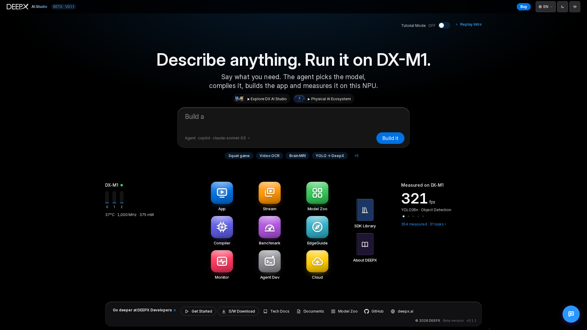

# DX AI Studio

An all-in-one desktop web workspace for building on the **DEEPX NPU**. Nine
specialized tools — model catalog, compiler, inference, streaming, benchmarking,
hardware monitor, deployment planner, an agent-driven builder, and AWS cloud compile — in one browser
experience, in six languages.



## The hub

The **hub** is the studio's home screen and the single place everything launches from.

- **Describe it, run it.** The prompt box (*Describe anything. Run it on DX-M1.*) takes a
  plain-words request: **Build it** first presents suggested tool routes or an agent plan.
  Select a route card to open a tool, or choose the execution button to start the agent
  on the home page. It does not immediately run a compile, inference or agent task.
- **One boot, all tools.** The launcher starts every module server for you on a short boot
  screen. The **tool cards** below the prompt show live facts (demo and model counts) and open
  each tool **embedded** in the hub, under one address.
- **This board at a glance.** The **DX-M1 widget** shows the NPU's cores, temperature, clock
  and power (click for DX Monitor); **Measured on DX-M1** shows FPS measured on this device
  (click for DX Benchmark). Inside every tool, the **NPU monitor** sits in the left rail as a
  thermometer button (its dot shows the temperature state); click it to unfold the readout.
- **Tutorial Mode** (top-right switch, on by default) runs a short walkthrough on the first
  visit and opens each tool's tutorial contents when you open it.
- **Built-in references.** The **SDK Library** (DEEPX docs & brochures, fully in-app) and
  **About DEEPX** open from the hub, next to the platform overview and the Physical-AI
  ecosystem page.
- **Always reachable.** The top bar carries **Buy**, the **language switch** (6 locales), the
  **theme** (dark / light / system), **Connected browsers** (when other computers can reach
  the studio) and **Tutorial**; the bottom bar links to Get Started, S/W Download, Tech Docs,
  Documents, Model Zoo, GitHub and deepx.ai; the **chat assistant** (bottom-right) answers
  SDK/module questions from any screen.
- **Consistent navigation.** The left rail switches modules, **Hub** at its bottom returns
  home, and top page tabs switch views within the selected module. Graph Composer is a
  page inside **DX App**, not a separate tool.

## Getting started

**Prerequisites:** Linux (Debian 12/13, Ubuntu 20.04–26.04) with **Python 3.8+**.
The base DX AI Studio package has **no third-party runtime dependencies**
(`dependencies = []`, Python standard library, ModelZoo tab included), and `./launcher.sh`
self-installs the package (editable) on first run, so
there's no manual `pip install` step. Real inference uses the DEEPX SDK and NPU; DX Stream
uses the system GStreamer + PyGObject. Live DX App runs (including Graph Live) need
`xvfb`, `libxcb1` and Pillow (typically `python3-pil`); Graph file-frame editing needs
Pillow and video-frame extraction also needs `ffmpeg`. Graph validation / execution
requires the dx_app graph runners (`multi_model_graph_sync` / `multi_model_graph_async`)
and the selected models. DX Cloud's real AWS operations use the optional `boto3` extra,
not a base Studio dependency.

**Layout:** DX AI Studio is meant to sit inside a `dx-all-suite` tree, alongside
sibling `dx-runtime` / `dx-compiler`. Running actual NPU inference or compiling models
uses the appropriate SDK from those siblings: local compilation needs the compiler SDK,
while NPU inference needs an NPU + driver, DX-RT and prepared models in
`dx-runtime/dx_app`. The Studio remains browsable without hardware, SDK,
or models; each tool says what is missing.

```bash
./launcher.sh
```

Then open the address it prints (the studio home). Wait for the boot screen to finish —
it starts all the tools for you — then click any tile on the hub to begin.

`./launcher.sh` uses `.venv/bin/python` if a virtual environment is present, otherwise
your system `python3`. See [`docs/development.md`](docs/development.md) for options
(`--port`, `--no-browser`, …) and environment variables.

## Managed runtime profiles

DX AI Studio treats the DEEPX runtime as an external, versioned host dependency. It
does not modify `dx-runtime` sources. The Studio-owned compatibility matrix in
`config/runtime_profiles.json` declares the supported runtime/driver package pairs,
immutable GitHub revision URLs, and SHA-256 digests. Package discovery uses installed
Debian package metadata, not the version of a source checkout.

- **Supported migration:** Studio can reconcile the declared `2.3.0` and `2.4.1` rollback
  profiles to the target `2.4.2` profile (DX-RT 3.4.2, NPU driver 2.6.0 — the runtime the
  suite release pins) on `x86_64` and `aarch64` hosts. A runtime it does not declare (for
  example a newer pre-release) is never replaced: reconciliation stops as blocked.
- **New dx-runtime release:** `python -m scripts.runtime_profile_update --write` reads the
  latest `DEEPX-AI/dx-runtime` release (or `--tag vX.Y.Z`) and adds its profile — revisions,
  DX-RT / driver versions from `RELEASE_NOTES.md`, `.deb` URLs and SHA-256 digests computed
  from the downloaded packages — and moves the target to it (`--keep-target` to only add).
- **Trust boundary:** packages are staged under Studio's `var/runtime/artifacts/`
  cache only after their declared SHA-256 digest matches. A digest mismatch never
  reaches a privileged package command.
- **Explicit authorization:** installing packages requires an explicit authorized
  Runtime Setup action. Studio invokes a non-interactive privileged `dpkg` command
  only after that authorization; browsing diagnostics and Setup remains available
  without it.
- **Launch gate:** App and Stream inference launches require a journaled `ACTIVE`
  profile that passed full validation, or — when Studio has not run the transaction —
  that module's own launch contracts validating live on this board. A failure returns a stable contract check ID
  and remediation rather than starting a child process with inherited shell paths.
- **Environment isolation:** inference children receive the Studio-selected Python,
  virtual environment, native library paths, GStreamer plugin directory, and
  postprocess path. `PYTHONPATH`, `VIRTUAL_ENV`, `LD_LIBRARY_PATH`, and
  `GST_PLUGIN_PATH` from the parent shell are not inherited.
- **Recovery:** a failed candidate validation triggers a verified reinstall and
  validation of the prior declared runtime profile. Studio outputs and its artifact
  cache are not runtime-install targets and are preserved during rollback.

Installing or changing a DKMS driver can require a reboot before NPU device nodes are
available. After a reboot, run the **DX-Runtime Dependencies** / **NPU Linux Driver** steps
in DX Stream **Setup** again to validate and activate the installed profile before starting
inference.

## What you can do

| Tool | What it's for |
|------|----------------|
| **DX App** | Run NPU inference on images, video, camera or RTSP; Run Demo, live multi-stream, benchmark & compare, and Graph Composer for multi-model / logic workflows. → [guide](docs/source/05_DX_App.md) |
| **DX Stream** | Real-time GStreamer vision-AI pipelines with live playback (WebRTC, or MJPEG from another computer). → [guide](dx_stream/README.md) |
| **DX Model Zoo** | Browse 497 canonical model variants across 29 tasks in the October 2026 reference; inspect artifacts, examples and metrics. → [guide](dx_modelzoo/README.md) |
| **DX Compiler** | Compile ONNX → `.dxnn`: config wizard, quantization tuning + diagnosis, re-quantization. → [guide](dx_compiler/README.md) |
| **DX EdgeGuide** | Recommend the best NPU board + host for your workload from real benchmarks. → [guide](dx_planner/README.md) |
| **DX Benchmark** | Browse and compare NPU throughput / latency / multi-stream results. → [guide](dx_benchmark/README.md) |
| **DX Monitor** | Live NPU + system telemetry (temperature, clock, utilization, versions). → [guide](dx_monitor/README.md) |
| **DX Agent Dev** | Describe an NPU app in natural language and have a coding agent build it. → [guide](dx_agent_dev/README.md) |
| **DX Cloud** | DEEPX on AWS Marketplace, and cloud ONNX → `.dxnn` compile on your DEEPX Compiler stack (optional `boto3`). → [guide](dx_edge/README.md) |

From the **hub** you can also open the **SDK Library** (DEEPX docs & brochures in-app),
**About DEEPX**, switch **language** (6 locales), and jump to the DEEPX store.

Every tool stays browsable when no NPU or SDK is present and says what is missing — DX Monitor
shows *NPU telemetry unavailable* rather than made-up values.

The catalog reference is dx_app dev `2e20108a5` and Studio's internal snapshot dated
2026-10-13 (348 → 497 entries, +149); variants are not distinct architectures.
Graph Composer can run **492** of those variants (excluding four anomaly models and
the LiDAR model). The loaded catalog / connected dx_app determine actual availability.
Use existing model images; a missing display image is not a reason to regenerate the
whole catalog.

## For developers

Maintainer documentation lives in [`docs/`](docs/):

- [`docs/architecture.md`](docs/architecture.md) — launcher hub + module servers + `shared/`, the proxy model, port map.
- [`docs/development.md`](docs/development.md) — Python 3.8+ venv, running modules, env vars, i18n workflow.
- [`docs/testing.md`](docs/testing.md) — test layers and how to run the gates.
