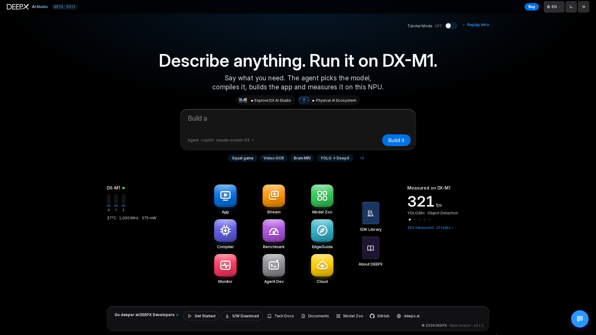

<div align="center">

# DX-AI-Studio (Beta)

**DEEPX NPU development in one browser workspace — from model to running app, without the CLI.**

[](https://developer.deepx.ai/tech-docs/DX-AllSuite/ai-studio/Installation_and_Launch/)


</div>



DX-AI-Studio puts the DEEPX SDK into one web workspace: browse models, compile, run inference and
streaming pipelines, benchmark, monitor the NPU and build apps with an AI agent — all launched from a
single hub, in a multilingual UI.

- **Describe it, run it** — type a request in the hub. Studio suggests a tool route or an agent plan, and nothing runs until you choose.
- **Works without hardware** — every tool opens without an NPU or SDK and tells you what is missing, instead of showing made-up results.
- **No pip install step** — the base package uses only the Python standard library and sets itself up on first launch.

## What You Need

Studio sits inside `dx-all-suite`, next to `dx-runtime` and `dx-compiler`, and uses their SDKs for real work.

| | |
|---|---|
| **Open and browse every tool** | Python 3.8–3.14 only |
| **Compile models** | DX-COM (`dx-compiler`) |
| **Run NPU inference** | A DEEPX NPU with its driver, DX-RT, and prepared models in `dx-runtime/dx_app` |
| **Run DX Stream pipelines** | System GStreamer and PyGObject, plus the DX-STREAM plugin and models (installed from DX Stream → Setup) |
| **Live DX App views (camera, RTSP, Graph Live)** | `xvfb`, `libxcb1` and Pillow (`python3-pil`) |
| **Graph Composer** | dx_app graph runners (`multi_model_graph_sync` / `multi_model_graph_async`); Pillow and `ffmpeg` for frame editing |
| **DX Cloud on AWS** | The optional `boto3` extra and AWS credentials |

Full details → [Installation and Launch](https://developer.deepx.ai/tech-docs/DX-AllSuite/ai-studio/Installation_and_Launch/)

## Quick Start

On Linux (Ubuntu 20.04–26.04 LTS, Debian 12 / 13) with Python 3.8–3.14:

```bash
cd dx-all-suite/dx-ai-studio
./launcher.sh
```

Your browser opens to the hub (or open the address it prints). Wait for the boot screen to finish — it starts every tool for you.
Then click any tool on the hub. Options such as `--port` and `--no-browser` → [Development Guide](docs/development.md)

## Tools

| Tool | What it does | Guide |
|---|---|---|
| **DX App** | NPU inference on images, video, camera or RTSP; Run Demo, live multi-stream, benchmark and compare, and Graph Composer for multi-model workflows | [Guide](https://developer.deepx.ai/tech-docs/DX-AllSuite/ai-studio/DX_App/) |
| **DX Stream** | Real-time GStreamer vision-AI pipelines with live playback (WebRTC, or MJPEG from another computer) | [Guide](https://developer.deepx.ai/tech-docs/DX-AllSuite/ai-studio/DX_Stream/) |
| **DX-ModelZoo** | Browse the DEEPX model catalog by task; inspect artifacts, examples and metrics | [Guide](https://developer.deepx.ai/tech-docs/DX-AllSuite/ai-studio/DX_Model_Zoo/) |
| **DX Compiler** | ONNX → `.dxnn` with a config wizard, quantization tuning and diagnosis | [Guide](https://developer.deepx.ai/tech-docs/DX-AllSuite/ai-studio/DX_Compiler/) |
| **DX EdgeGuide** | Recommends the NPU board and host for your workload from real benchmarks | [Guide](https://developer.deepx.ai/tech-docs/DX-AllSuite/ai-studio/DX_EdgeGuide/) |
| **DX Benchmark** | Browse and compare NPU throughput, latency and multi-stream results | [Guide](https://developer.deepx.ai/tech-docs/DX-AllSuite/ai-studio/DX_Benchmark/) |
| **DX Monitor** | Live NPU and system telemetry: temperature, clock, utilization, versions | [Guide](https://developer.deepx.ai/tech-docs/DX-AllSuite/ai-studio/DX_Monitor/) |
| **DX Agent Dev** | Describe an NPU app in plain language and have a coding agent build it | [Guide](https://developer.deepx.ai/tech-docs/DX-AllSuite/ai-studio/DX_Agent_Dev/) |
| **DX Cloud** | DEEPX on AWS Marketplace and cloud ONNX → `.dxnn` compile | [Guide](https://developer.deepx.ai/tech-docs/DX-AllSuite/ai-studio/DX_Edge_AWS/) |

The hub also opens the **SDK Library** (DEEPX docs and brochures in-app), a **chat assistant** for SDK
questions and a first-visit **Tutorial Mode** → [The Hub](https://developer.deepx.ai/tech-docs/DX-AllSuite/ai-studio/The_Hub/)

## Runtime Management

Studio can install and switch the DEEPX runtime (DX-RT and NPU driver) from **DX Stream → Setup**,
using a pinned list of verified versions:

- Packages are installed only when you explicitly authorize it, and only after their SHA-256 digest matches.
- Studio never modifies `dx-runtime` sources, and rolls back to the previous verified runtime if validation fails.
- After installing or changing the driver, reboot, then run the **DX-Runtime Dependencies** and
  **NPU Linux Driver** steps in **Setup** again before starting inference.

How profiles, validation and rollback work → [Development Guide](docs/development.md#managed-runtime-profiles)

## Documentation & Support

- **User Guide** — [Installation and Launch](https://developer.deepx.ai/tech-docs/DX-AllSuite/ai-studio/Installation_and_Launch/) · [The Hub](https://developer.deepx.ai/tech-docs/DX-AllSuite/ai-studio/The_Hub/) · one chapter per tool (see the Tools table above)
- **Developer Guide** — [Architecture](docs/architecture.md) (launcher, module servers, proxy, ports) · [Development](docs/development.md) (venv, env vars, i18n, runtime profiles) · [Testing](docs/testing.md) (test layers and gates)
- For technical questions, please ask in the DEEPX Developer Community: https://community.deepx.ai/c/support/5

Copyright © DEEPX Co., Ltd.
