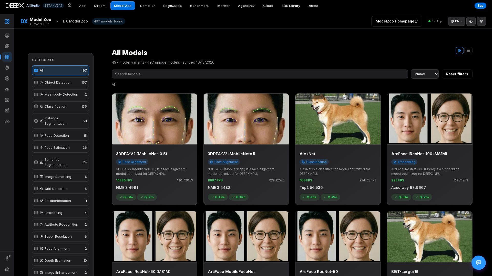
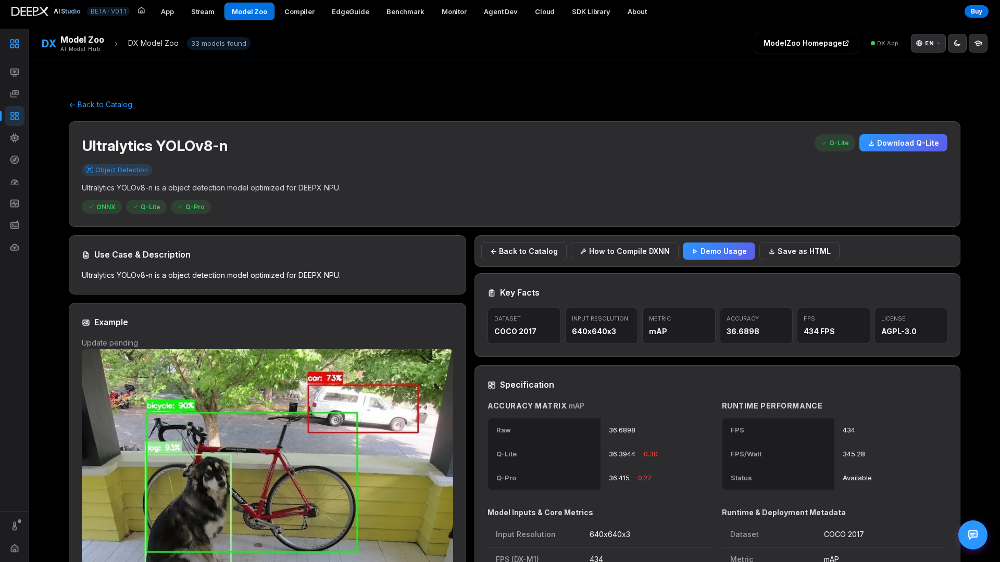
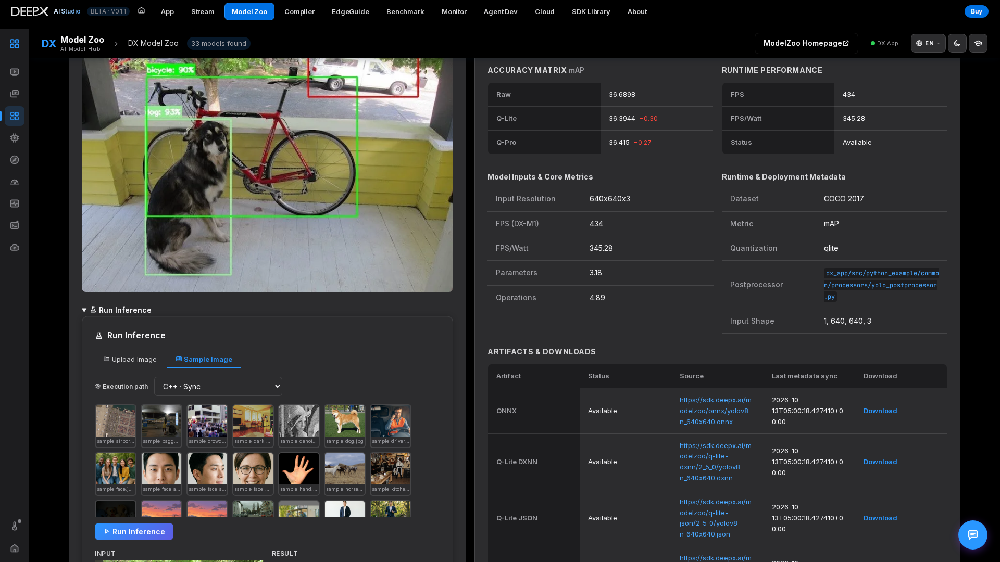

# DX Model Zoo

Browse the DEEPX model catalog — search and filter by AI task, open a
model to see its details (accuracy, input, license / source), and use it in the other
studio tools.

The October 2026 reference is **497 canonical model variants across 29 tasks**, aligned
with dx_app dev `2e20108a5`. Variants include different sizes, inputs and training variants;
this does **not** mean 497 distinct architectures. The Studio internal snapshot dated
**2026-10-13** grew from 348 to 497 entries (+149). The explorer's variants / unique-model
counts and sync date describe the loaded catalog; a different source or revision can differ.
The Hub and Zoo UI group these entries under **31 category labels**, while the Graph
palette uses **29 canonical tasks**; these are different groupings of the same 497 variants.

## Using it

Step 1. **Browse or search** the catalog; filter by **category** (image classification,
   object detection, segmentation, pose, …), toggle **card / list** view, and sort. Cards
   show the available **Q-Lite / Q-Pro** artifacts; **Q-Master** appears only where provided.

Step 2. **Open a model** to see its detail view: task, input shape, accuracy metrics, legal
   info (license / source / copyright), and example images. The desktop detail view groups
   Key Facts, Example, artifacts / actions and metrics in a 2×2 layout. A before/after
   slider is available for suitable examples, including super-resolution: open a
   Real-ESRGAN variant and compare its existing input / result images.

Step 3. **Download** an available artifact — a Q-Lite / Q-Pro `.dxnn` (with progress /
   cancel), ONNX or JSON. Not every model provides every artifact or quantization tier.

Step 4. **Try it in-browser** — run inference right from the detail view (upload or sample
   image) against your local DX App: see the result image, predictions, FPS, and a
   per-stage latency table, and switch the execution path (C++/Python × Sync/Async).
   DX App must be reachable, the selected model downloaded, its example prepared / built,
   and the NPU runtime ready. Non-image tasks do not necessarily support this image demo.
   
Step 5. Or pull the model into **[DX App](05_DX_App.md)** or **[DX Compiler](04_DX_Compiler.md)**
   (the detail view also links straight to "View Model Graph" and a compile guide).  

## Key features

- **497 canonical variants / 29 tasks** in the reference catalog, with per-category filtering, search, sort,
  and card/list views.  
- **In-browser inference demo** and one-click artifact **downloads** from the detail view.  
- **Rich detail view** — accuracy, license / source / copyright, copyable demo code
  (C++/Python/CLI), and save-as-HTML model card.  

## Reading results and recovering

- Card FPS and accuracy are **published catalog measurements**, not a guarantee for your
  board. Keep the metric name (for example mAP, top-1 or NME), dataset and quantization
  tier with the number; local inference timings describe a different execution.
- If inference is disabled or fails, check DX App **Setup**, download the selected tier
  and build its example before retrying. Missing example media alone does not mean the
  model needs to be re-inferred: reuse the supplied model images where available.
- The full catalog is not the Graph execution list. **492** variants are runnable in
  DX App's Graph Composer at the reference revision; the four anomaly models and the
  LiDAR model are excluded. See [DX App](05_DX_App.md#graph-composer).
