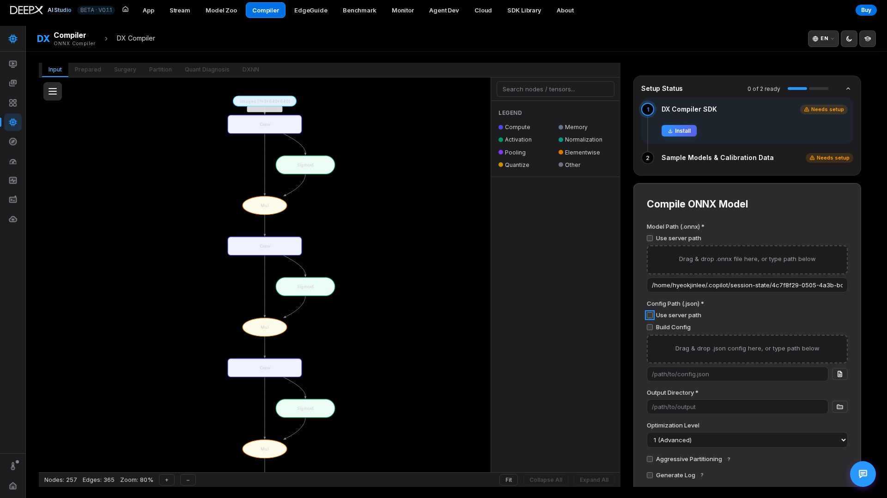
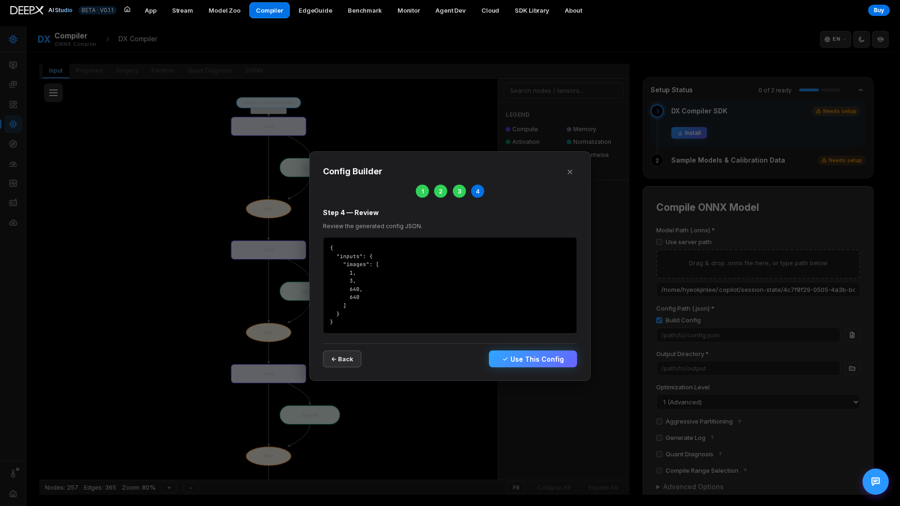

# DX Compiler

Compile a trained **ONNX model into a `.dxnn` binary** that runs on the DEEPX NPU — with
a guided config wizard, live graph visualization, quantization tuning and diagnosis,
subgraph (range) compile, re-quantization, and an optional AI agent that does the whole
thing for you.

## What you can do

- One-click **ONNX → DXNN** compilation with a live progress bar and log.  
- Build the compile **config** with a 4-step wizard — no hand-editing JSON.  
- **Visualize** the model graph at each stage (Input → Prepared → Surgery → Partition → DXNN).  
- Tune **quantization** (DXQ presets or automatic Q-Pro) and read a **Quantization
  Diagnosis** report that tells you whether the quantized model is healthy.  
- Compile only **part of a model** by picking start/end nodes on the graph.  
- **Re-quantize** a `.qxnn` artifact into a new `.dxnn` without re-running everything.  
- Let an **AI agent** compile from just a model name / path / URL.  

## Using it

### 1. Setup (first run)

In the **Setup** panel, check the SDK / sample status. If the compiler SDK is missing,
click **Install**; optionally **Download** sample models + calibration data. The Compile
button stays disabled until the SDK is ready. Read the incomplete / locked step's reason,
finish that step, and re-check its status before retrying; a loaded model graph alone
does not mean the compiler is installed.

### 2. Choose the model

In **Compile ONNX Model**, drag & drop an `.onnx` file (or type its path). Toggle **Use
server path** to point at a file already on the server.

### 3. Choose the config

Drag & drop a config `.json`, or tick **Build Config** to open the wizard:

Step 1. **Input Shapes** — **Auto Detect from Model**, or add input rows manually.  

Step 2. **Data Loader** — **Default Loader** (real calibration data) or **Dummy Loader** (random tensors,
   quick check).  

Step 3. **Dataset & Preprocessing** — dataset path, file extensions, a preprocessing pipeline
   (resize / normalize / …), calibration samples & method. *(skipped for Dummy)*  
   
Step 4. **Review** — review the generated JSON, then **Use This Config**.

For example, use **Default Loader** with a dataset folder accessible on the Studio host,
check the model's resize / normalization, and review the JSON before applying it. The
wizard requires a dataset path for this loader. Use **Dummy Loader** only for a quick
compilation check, not as evidence of calibrated accuracy.

### 4. Options

Set **Output Directory** and **Optimization Level**. Optional toggles: **Aggressive
Partitioning** (more nodes on the NPU), **Generate Log**, **Quant Diagnosis**, **Compile
Range Selection**. Under **Advanced Options → DXQ Enhancement Scheme**, enable
quantization presets **DXQ-P0…P5** (each with its own parameters) or **Auto (Q-PRO)** for
automatic tuning (Auto is mutually exclusive with the manual presets).

### 5. Compile

Click **Compile** — watch the **Current Phase** progress card and the live **Compiler
Log**; graph tabs unlock as each phase finishes. On success, **Save Model Summary**
downloads an HTML report of the compile.

## Key features

- **Quant Diagnosis** — tick it before compiling to generate a Quantization Diagnosis
  HTML report (opens in the **Quant Diagnosis** tab). It shows the model **Status**, plus
  **Action Items** and **Evidence** (omitted when Status is **GOOD**). A diagnosis
  failure does not fail the compile.  
- **QXNN Resume (re-quantization)** — the **Resume from QXNN** card re-quantizes an
  existing `.qxnn` into a new `.dxnn`: change the **Recalibration Method**
  (minmax / ema / iqr) and/or apply **Q-Pro / DXQ** presets, without re-running the full
  pipeline. **Dataset Path (optional)** overrides the calibration dataset when needed.
  For example, open a completed diagnosis, choose **Resume from this QXNN →**, review
  the prefilled artifact, choose the new method / presets and optional dataset, then
  start the resume and inspect its log and new output. A diagnosis report is guidance,
  not an accuracy guarantee.
- **Compile Range Selection** — after the Prepare phase, use **Set Input Nodes** / **Set
  Output Nodes** on the graph, **Calculate Range**, then **Resume Compilation** to compile
  only the chosen subgraph.  
- **Graph Viewer** — pan / zoom, **Fit**, **Collapse / Expand All**, `Ctrl+F` node
  search, click a node / tensor for details; a color-coded **Legend** by node category.  
- **Agentic Auto Compile** — give a model name / path / URL, pick an agent (with LLM model
  and reasoning-effort; only the agents installed on this machine are listed), and it downloads, converts, configures, compiles, and verifies
  automatically — either fully hands-off or **interactive** (you can reply mid-run).  
- **Sample-model picker** — the **Select Sample Model** button fills the Model Path from an already-downloaded
  sample.  
- **AI Assistant** chat (floating button) explains errors and settings.  

If compilation is refused or fails, read the Setup reason or the last failing phase in
**Compiler Log**, correct the SDK / input / dataset / config, and retry. A diagnosis
failure is separate from compilation success; do not treat a graph preview or an
incomplete job as a produced `.dxnn`.

!!! note "Related"
    Compiler outputs (`.dxnn`) run in **[DX App](05_DX_App.md)** and
    **[DX Stream](06_DX_Stream.md)**. Source models come from
    **[DX Model Zoo](03_DX_Model_Zoo.md)**.  
