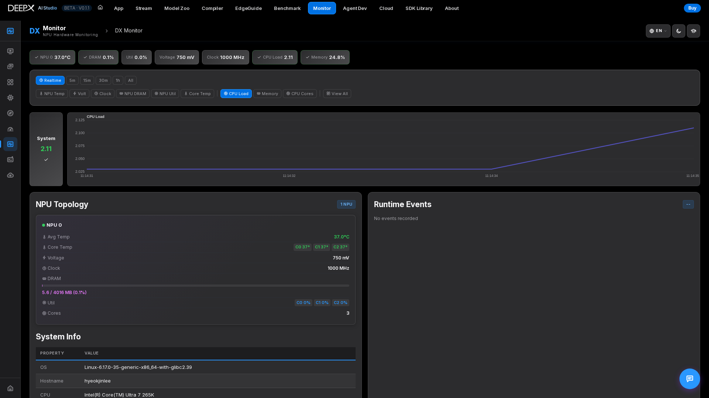
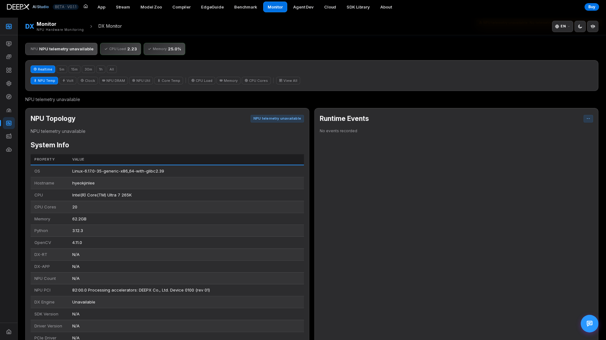

# DX Monitor

A real-time hardware dashboard for your DEEPX NPU and host — temperature, voltage,
clock, DRAM, and utilization, alongside CPU and memory, plus the installed SDK / driver
versions.

## Using it

Step 1. Open the dashboard — live **NPU** telemetry per device (temperature, voltage, clock,
   DRAM, per-core utilization) and **system** stats (CPU per-core, load, memory).  

Step 2. Pick a **time range** (Realtime / 5m / 15m / 30m / 1h / All — up to ~12h history) and
   switch which metric the charts show, or "View All" as a grid.  
   
Step 3. Watch the live charts while you run inference or benchmarks in the other tools; charts
   stream over SSE (with a polling fallback shown when SSE is down).  

For example, keep Monitor open, start an image or video run in DX App, and compare the
NPU utilization / temperature before and during the run. Confirm that telemetry is
**real and current** before interpreting the chart as evidence of that run.

## Read availability before the numbers

| State | Meaning | What to do |
|-------|---------|------------|
| Real / current | The telemetry worker is supplying current NPU samples. | Read per-device values together with the selected time window. |
| **NPU telemetry unavailable** | No usable NPU samples are available; host stats can still work. | Check the shown diagnostic, DX-RT / `dx_engine`, driver and `dxrt-cli --status`; repair the environment and re-check. |
| **NPU telemetry is not current** (stale) | The source is not providing current samples. | Do not treat retained values as live; check the diagnostic and source recovery. |
| **Mock** | Explicit UI demonstration data, enabled by `DX_MONITOR_EXPLICIT_MOCK=1`. | Do not use it as measured hardware or performance evidence. |

An SSE connection reports **transport**, not NPU health: it can carry unavailable or
stale status. The browser accumulates chart history while it receives samples (up to
about 12 hours); it is not a server-side recording archive. A fresh page session starts
collecting again, and reconnecting cannot recover samples missed while disconnected.
Wait for fresh samples after recovery before judging a run.

## Key features

- **Live NPU telemetry** per device with warn / critical **threshold alerts** (limit lines
  on the charts), per-core NPU temperature, and per-channel DRAM temperature.  
- **NPU Topology** — firmware, chip / variant, board, DDR type / freq / size, per-core util.  
- **DDR ECC alerts** — single-/double-bit error (SBE/DBE) warnings.  
- **Runtime Events log** — INFO / WARN / ERROR / CRITICAL entries from the runtime.  
- **System stats** — CPU per-core, load, memory.  
- **Version info** — DX-RT / PCIe driver / DX Engine / SDK / OS / Python versions, uptime.  
- With no NPU, shows **NPU telemetry unavailable** — it never shows made-up values; CPU and memory
  are always real. Mock telemetry appears only when started with `DX_MONITOR_EXPLICIT_MOCK=1` (marked Mock).  

Skipping hardware initialization is not a request for mock telemetry. Only the explicit
mock setting above enables synthetic NPU values.

!!! note  
    The same version and device information is available on the command line via
    `dxrt-cli --status`.
