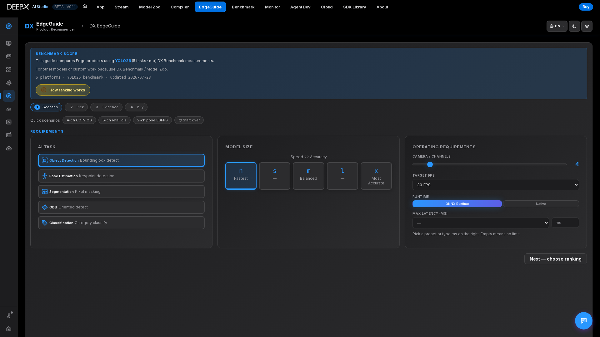

# DX EdgeGuide

Pick the best DEEPX Edge AI product (NPU board + host) for your computer-vision
workload. Describe the workload; EdgeGuide ranks the platforms that can handle it using
real **YOLO26 benchmark** measurements, then lets you drill into a platform, compare it
with another, review the evidence, and get product info / a price quote.

## Using it

The whole tool is one page with a four-step strip — **Scenario → Pick → Evidence → Buy** —
where panels open as you go.

### 1. Describe the workload (Requirements panel)

- Optionally click a **Quick scenario** chip (**4-ch CCTV OD / 8-ch retail cls / 2-ch pose 30FPS**) to prefill.  
- **AI task**: Object Detection / Pose Estimation / Segmentation / OBB /
  Classification.  
- **Model size**: n (fastest) → x (most accurate).  
- **Operating requirements**: cameras / **channels**, **target FPS**, runtime
  (ONNX Runtime vs Native), **max latency**.  
- Click **Next — choose ranking**, choose a **ranking priority** — Most Channels / Best
  Performance (camera-pipeline FPS) / Lowest Power (NPU TDP; host power not included) —
  then **Get Recommendations**. (After the first run,
  changing any input auto-refreshes the results; **Start over** clears everything.)  

### 2. Read the recommendations

A verdict line shows the **Top pick** and whether your channel / FPS target is met. Each
card carries a **Measured** or **Estimated** badge and one line saying why — for example
"12 ch held 30.4 FPS each ≥ 30 FPS target (measured) · 13 ch dropped to 28.1 FPS", or the
division an estimate comes from, "534 FPS ÷ 60 FPS = 8.9 → 8 ch (estimated from the measured
total; tested up to 18 ch)".

How the channel count is worked out: the multi-stream benchmark measured the stream counts
around 30 FPS per channel. When a measured count holds your target and the next one misses
it, that count is the answer (measured). Otherwise the count is estimated as
`floor(T_sat / target)`, where `T_sat` is the lowest measured total FPS — around saturation
the total stays nearly flat as streams are added — and an estimate never exceeds twice the
highest tested count; **Estimated+** means the estimate hit that cap, so the real capacity may
be higher. The quotient is shown cut to one decimal, never rounded up past the floor. A
measurement taken while the NPU throttled is kept (its FPS already ran at throttled clocks) but
flagged, and ranks after an equal cool result. The **limit** note says **NPU** when the NPU was
at least 85 % busy at the most loaded measured stream count, otherwise **host** (CPU / decode /
PCIe), and shows that NPU load — a faster host helps in the second case, a bigger NPU in the
first. Notes also say when latency was not measured — with a latency budget set, an unmeasured
latency never counts as a plain pass. **How ranking works** shows every formula with its
meaning in your language, plus a summary of the current session.
Click a card (or a bar in the throughput chart) to open details.

### 3. Explore / compare

The Details panel shows key facts, platform specs, a Performance Radar, a sortable
benchmark table, and a per-model-size chart; **task tabs** let you view the same platform's
numbers for other AI tasks. The charts and table are interactive — click a model-size bar
or a table row to re-run the recommendation at that size. Use **Compare with** to line up
a second platform side by side (with a summary count of Meets / Insufficient).

### 4. Buy / contact

Pricing is by quote — the Buy panel's **Product info** and **Request quote** buttons go to
DEEPX.

## Key features

- **Real measurements** — recommendations come from the YOLO26 benchmark matrix, not
  spec-sheet math. Channel counts are measured where a tested stream count brackets the
  target, and otherwise estimated from the measured total FPS — every card says which.  
- **Open methodology** — the **How ranking works** button shows the exact formulas and a
  live summary; it also states the honest limits (the figures are not a full spec sheet;
  the power ranking covers the NPU only; contact DEEPX for production sizing and pricing).  
- **Multi-stream evidence** — per-channel and total FPS behind each channel estimate.  
- **Shareable & resumable** — the current selection is captured in the URL (a link, e.g.
  arriving from [DX Benchmark](08_DX_Benchmark.md), reproduces the inputs and re-runs), and
  your last inputs are also restored locally on reload.  
- **AI Help** chat for follow-up questions grounded in your requirements / results.  
