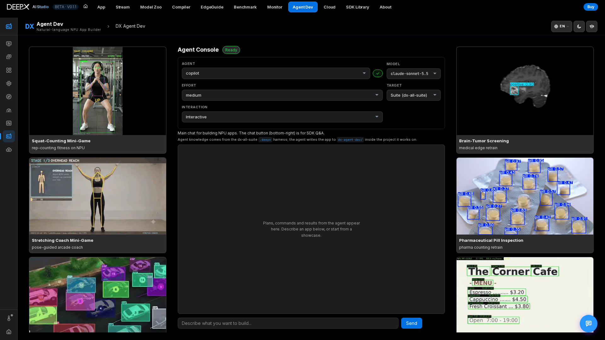
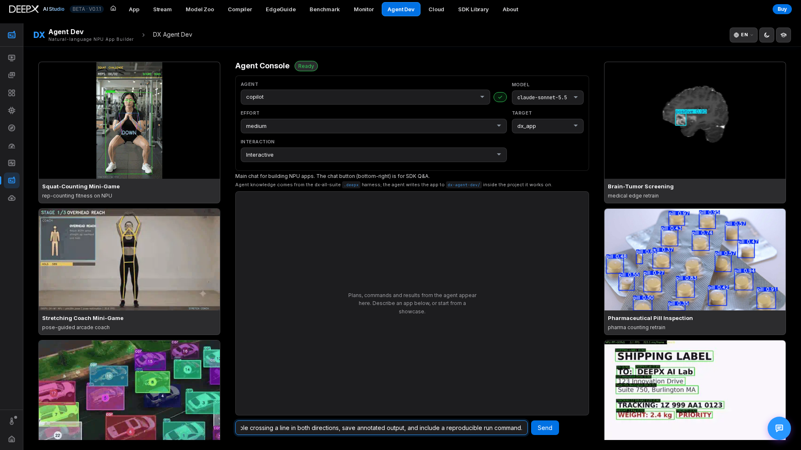

# DX Agent Dev

A natural-language console for building DEEPX NPU apps: describe what you want, and a
coding agent generates and runs it. It is also a chat assistant and a gallery of
ready-made showcases.

## Using it

Step 1. **Connect an agent** — the console detects installed coding CLIs. Five are supported:
   **Claude Code** (`claude`), **GitHub Copilot CLI** (`copilot`), **Cursor**
   (`cursor-agent`), **Codex** (`codex`), and **OpenCode** (`opencode`). A badge shows
   whether each is signed in; if a login is needed it shows the exact command to run,
   then re-checks.  

Step 2. **Set the run** using the console controls:  
  - **Agent picker** — which of the 5 CLIs to use. The agent and model you pick are saved
      as the Studio agent (`~/.dx-ai-studio/agent.json`) and shared by Home, Agent Dev and the chat.  
  - **Model picker** — a dropdown of that agent's models; for CLIs that support
      listing them (Copilot — the models this account may use —, Cursor, OpenCode) it's
      enumerated live from the CLI, otherwise it falls back to a built-in list. A hint warns if the chosen model is too weak and
      suggests a stronger one.  
  - **Reasoning-effort picker** — the effort levels that agent's CLI supports.  
  - **Target** — which repo the agent works in: Suite, dx-runtime, dx_app,
        dx_stream, dx-compiler.  
  - **Interaction** — Interactive (asks questions) or **Autopilot (no questions)**.

Step 3. **Describe your task** in the prompt — the agent works and streams its progress live;
   an expandable **activity panel** shows each turn's shell / tool output next to the reply.
   The agent writes the generated app to `dx-agent-dev/<session_id>/` inside the sub-project it worked on
   (for example `dx-runtime/dx_app/dx-agent-dev/…`).
   The same run can also be started from the **prompt box on the hub home** and followed
   there (activity, replies, resume).

Step 4. **Chat** — the main console chat is for building NPU apps via the connected coding
   agent. The **chat button** (bottom-right) is a separate affordance: a general SDK Q&A
   assistant, not part of the Agent Console run.

Step 5. **Showcases** — browse the gallery of example NPU apps for reference. Open a
   showcase to inspect its README, recorded workflow and artifacts; viewing these
   does not start a new agent or NPU run.

### Follow up, stop or recover

For example, choose **Target → dx_app** and **Interactive**, ask the agent to explain
the input / output plan for an image-inference app, then reply to its question in the
same console. Follow-up messages continue the conversation when the CLI supports resume.
Inspect **Agent activity** and the generated files before treating a build as usable;
an agent's prose alone is not verification.

Use **Stop** during a run to request cancellation and wait for **Stopped**. Cancellation
does not undo files or external actions already performed. If the connection drops,
read the displayed error / status and reconnect to check the existing run before
submitting the task again. Reply in the retained conversation to continue where
supported; do not assume a disconnected browser means the work completed or was undone.

### If no CLI is available, or the harness isn't found

- **No coding-agent CLI installed/authenticated** — install and log into one of the 5
  above, then reload the page. Showcases remain useful for browsing. The separate
  chat assistant can use a configured local / cloud provider without a coding CLI;
  with no connected AI it gives basic built-in guidance, not a real AI build.
- **`.deepx` harness directory not found** — the agent knowledge/skills directory is
  missing. Set the `DX_HARNESS_ROOT` environment variable to your dx-all-suite checkout,
  or run DX AI Studio from within the suite, then reload the page.  

## Key features

- **Bring-your-own agent** — uses whatever coding CLI you have installed and signed in;
  one login powers both the generator and the chat.  
- **Studio chat (the button at the bottom right)** — separate from the Agent Console; it
  answers through your signed-in coding agent by default, or a **local / self-hosted**
  OpenAI- or Ollama-compatible endpoint (models are auto-discovered) or a cloud API key;  
  **Refresh knowledge** for the DEEPX SDK documentation is under Settings ▸ Advanced.  
- **Live streaming** of the agent's work, with a wall-clock timeout so a stuck run frees
  the slot for the next request.  
