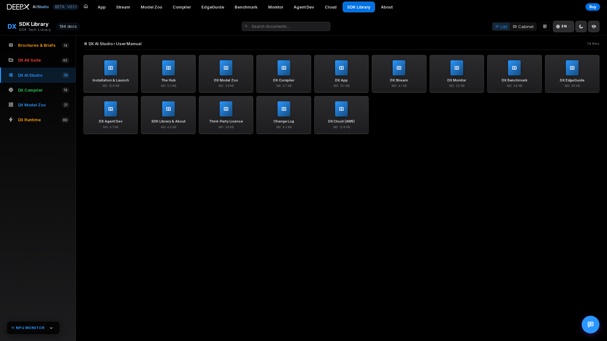
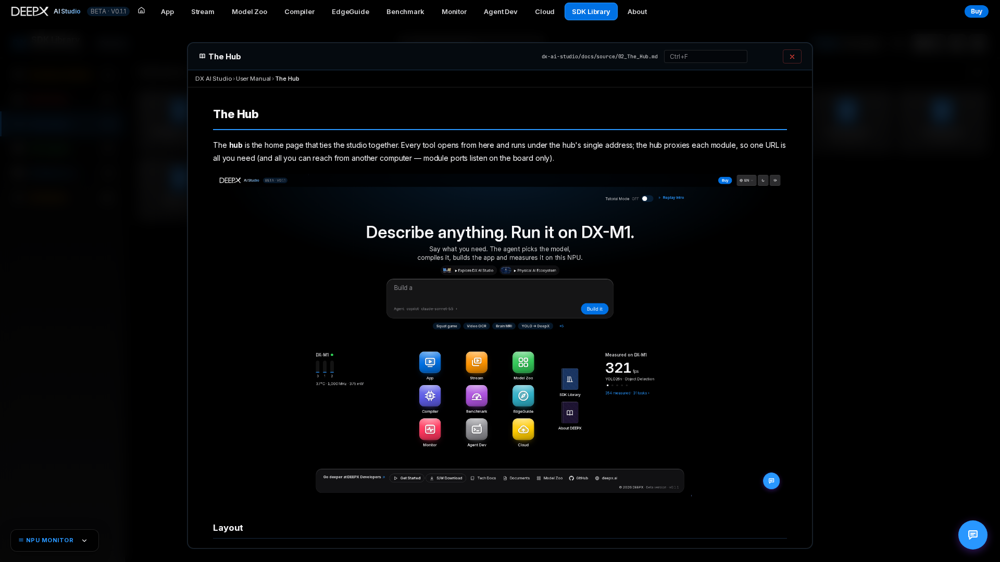
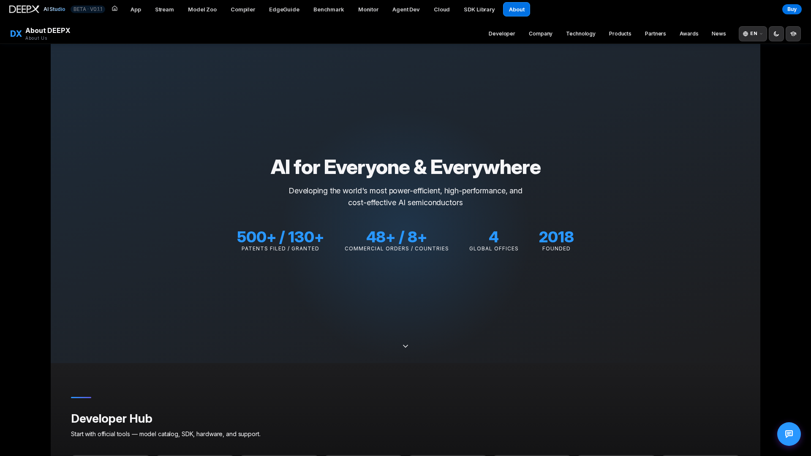
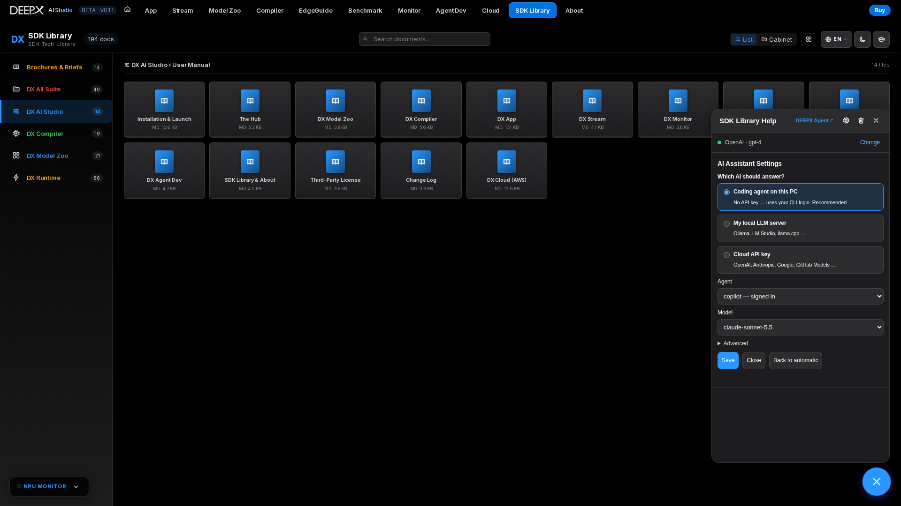

# SDK Library & About

Besides the nine tools, the hub hosts two reference views.

## SDK Library

An in-app library of DEEPX documentation and marketing material, reachable from the hub.  

- **Documentation** — renders the DEEPX SDK markdown docs (architecture overview,
  environment setup, first-model walkthrough, version compatibility, FAQ, and each
  sub-project's guides) directly in the browser, with images and tables.  
- **Brochures & Briefs** — product brochures and chip / module briefs as in-app PDFs.  
- **Search & deep links** — library-wide search plus in-document find (`Ctrl+F`, with
  next / prev and a match counter). Toggle **list / cabinet** view, or open the
  **architecture diagram** overlay. The open document, view mode, and query are captured
  in the URL, so a link reopens exactly that state.  

For example, select a documentation category, search for **runtime**, and open a matching
guide. **List / Cabinet** changes how library entries are displayed; it is not the
document viewer itself. Inside the opened document, use `Ctrl+F` to find a term and
copy its URL to reopen that document. If an entry is unavailable, check that the
corresponding suite documentation is present; a library entry alone does not install
the SDK or fetch missing source files.

## About DEEPX

The **About DEEPX** page introduces the company behind the studio — the "AI for Everyone
& Everywhere" mission, at-a-glance figures (patents, commercial orders, global offices,
year founded), and a **Developer Hub** with quick links to the model catalog, SDK,
hardware, and support.

The **About DEEPX** page presents company and product information down one scrolling page
with a sticky section nav (scroll-spy): a **Developer** section (dev-resource cards, CTAs,
and distribution channels), a **Company** section (vision, milestones timeline, global
offices), a **Technology** section (the DXNN SDK full-stack architecture), and **Products**, **Partners**,
**Awards**, and **News** sections — plus a shortcut to the DEEPX store. Available in all
six UI languages.  

## Chat / AI Assistant

The **chat assistant** (bottom-right button) is available in every DX AI Studio module (not just this one). Click
it anytime to ask about DEEPX models, the SDK, the compiler, or how any module works — it
draws on bundled DEEPX SDK knowledge to answer.  

The line at the top of the chat always says who answers. With nothing set, it answers through
the **coding agent you are signed in to** (`claude`, `copilot`, `cursor-agent`, `codex` or
`opencode`) — no API key needed, and the same Studio agent that Home and Agent Dev use. Note
that a coding agent answers from its vendor's cloud with that account's usage.

**Change** (or ⚙️) asks one question — *Which AI should answer?*  

- **Coding agent on this PC** — pick an installed CLI; each shows whether it is signed in, or
  the command that signs it in.  
- **My local LLM server** — your own Ollama-compatible server (Ollama, LM Studio, llama.cpp …).  
- **Cloud API key** — OpenAI, Anthropic, Google, GitHub Models, or a custom
  OpenAI-compatible endpoint.  

Saving tests the connection first; if it fails, the reason is shown with **Save anyway**.
Leaving the key field blank keeps the saved key. **Back to automatic** forgets the choice.
Temperature and **Refresh knowledge** (re-sync the assistant's SDK knowledge with the latest
`.deepx` docs) are under **Advanced**. With no agent signed in and nothing set, the assistant
gives basic built-in guidance and says how to connect an AI.

For example, choose **My local LLM server**, enter your reachable endpoint, select one
of its discovered models and save. If the test fails, check the URL / service and retry;
**Save anyway** stores the selection despite that failure, not proof of a working AI
connection. Use **Back to automatic** to return to the signed-in Studio agent.

The chat walkthrough (who answers, the one settings question, Refresh knowledge) is in the
launcher's onboarding tour, rather than repeated per module.  
