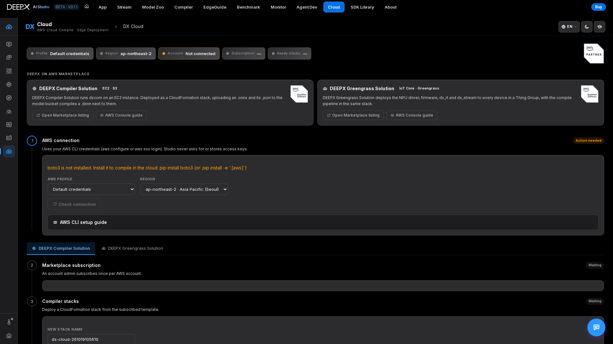
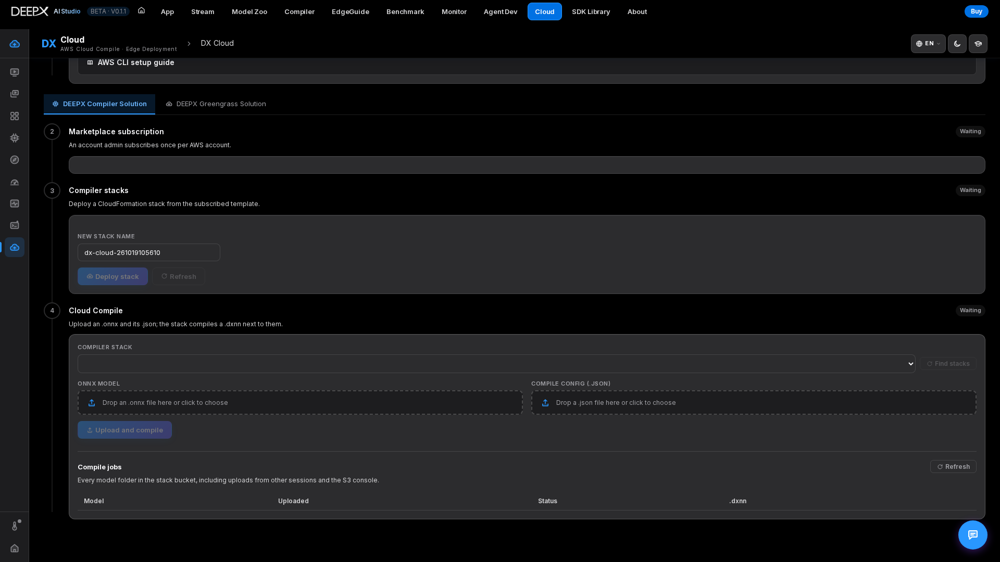
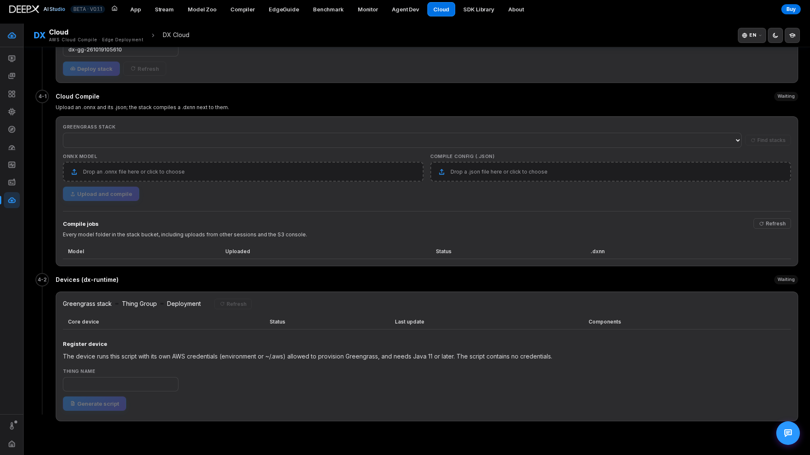

# DX Cloud (AWS)

DEEPX on AWS from inside Studio: connect an AWS account, check the two Marketplace
products, create or select a CloudFormation stack, then compile an `.onnx` into a
`.dxnn` — no local `dxcom` needed. The Greengrass product also provides device and
runtime-component status and a device registration script. Open **DX Cloud** from the
hub tile, at `/cloud/`, or with `Alt`+`9`.

The internal Python package is named `dx_edge`. This page is not **DX EdgeGuide**
(the product recommendation tool) or the suite's separate `dx-edge` guides.

## AWS Marketplace

- **DEEPX Compiler Solution** ([AWS Marketplace](https://aws.amazon.com/marketplace/pp/prodview-ev6ed5omu4ulo))
  runs `dxcom` on an Amazon EC2 instance. Deployed as a CloudFormation stack it becomes an
  event-driven pipeline: an `.onnx` and its `.json` uploaded to the stack's model bucket
  start a Lambda trigger → Step Functions → a compiler instance, which writes the `.dxnn`
  next to them. The workflow includes instance termination; verify cleanup separately
  from the presence of a result file.
- **DEEPX Greengrass Solution** ([AWS Marketplace](https://aws.amazon.com/marketplace/pp/prodview-732s46qfzuh34))
  deploys the `com.deepx.dx-runtime` component (NPU driver, firmware, `dx_rt` and
  `dx_stream`) to compatible, registered Greengrass core devices in an IoT Thing Group,
  with a cloud compile pipeline in its stack. This is runtime deployment, not automatic
  deployment or inference of the compiled model.

The full walkthrough — stack parameters, ZTP checks, cost and cleanup — is in the
[DX-Edge guides](https://github.com/DEEPX-AI/dx-all-suite/blob/main/dx-edge/README.md).

## Connect to AWS

Studio's base web runtime uses Python 3.8+ and the standard library. **Actual AWS API
operations require optional `boto3`**, installed in the Python environment running
Studio, for example `python3 -m pip install -e '.[aws]'` from the Studio package root.
Without it the page and guide remain available, but AWS operations cannot run.

DX Cloud uses boto3's credential chain on the **Studio host**, optionally selecting a
named profile from `~/.aws`. It has no UI for entering, uploading or storing access
keys. Configuring credentials only on a remote browser's computer does not configure
the Studio host. The AWS CLI commands below help set up credentials or SSO; the
backend calls boto3, not the `aws` executable. The same setup guide is in step ① of
the page, with a copy button on every command.

**1. Install AWS CLI v2.** One script for Linux `x86_64` and `aarch64` — it picks the
package for this machine (install `unzip` and `curl` first if they are missing:
`sudo apt install -y unzip curl`):

```bash
ARCH="$(uname -m)"   # x86_64 or aarch64
case "$ARCH" in
  x86_64|aarch64)
    curl "https://awscli.amazonaws.com/awscli-exe-linux-${ARCH}.zip" -o awscliv2.zip
    unzip -q awscliv2.zip
    sudo ./aws/install --update
    aws --version ;;
  *) echo "AWS CLI v2 for Linux supports x86_64 and aarch64 only (this machine: $ARCH)" ;;
esac
```

See the [AWS CLI install guide](https://docs.aws.amazon.com/cli/latest/userguide/getting-started-install.html).

**2. Configure credentials** ([AWS CLI configuration guide](https://docs.aws.amazon.com/cli/latest/userguide/cli-chap-configure.html)).

- *Option A — access key:* create one in the IAM console (Users → Security credentials →
  Create access key), then run `aws configure`:

    ```text
    $ aws configure
    AWS Access Key ID [None]: AKIA****************
    AWS Secret Access Key [None]: ****************************************
    Default region name [None]: ap-northeast-2
    Default output format [None]: json
    ```

- *Option B — IAM Identity Center (SSO):* `aws configure sso` once to create a named
  profile, then `aws sso login --profile <name>` whenever the session expires.

**3. Verify** with `aws sts get-caller-identity` (add `--profile <name>` for the named
profile you intend to use).

**4. Permissions.** The identity needs CloudFormation, S3, Step Functions, SSM
`GetParameter`, EC2, IAM (stacks are created with `CAPABILITY_IAM`), CloudWatch Logs and
Lambda; the Greengrass tab also needs Greengrass V2 and IoT. An account admin accepts the
Marketplace subscription.

**5. Check connection.** Select **AWS profile** and **region**, then press **Check
connection** in step ①. The profile list reloads without a restart and the account and
ARN appear when identity verification succeeds. The region initially follows the
profile, falling back to `ap-northeast-2`. If SSO has expired, sign in again on the Studio
host, then repeat the check. A successful identity check does not establish permissions
for every subsequent operation.



*Preparation-state overview: boto3 is not installed and AWS is disconnected. These
three UI views were captured without AWS operations and do not demonstrate successful
compilation or deployment.*

## Subscribe and prepare a stack

1. Choose **DEEPX Compiler Solution** or **DEEPX Greengrass Solution**. Each product has
   its own **Marketplace subscription** check; one subscription does not establish the
   other's status. An account admin accepts the relevant Marketplace terms, then you
   use **Refresh** in Studio.
2. The check resolves the selected product template's AMI SSM parameter in the chosen
   account and region. It is not a billing check or a guarantee that a particular AMI
   version, region or instance type is currently available. Check the Marketplace
   listing and account permissions if it fails. The bundled template labels and older
   AWS Console guide images are reference versions, not live availability claims.
3. Use **Find stacks** to select an existing compatible stack, or enter a stack name
   and create one in Studio. Watch its status and recent CloudFormation events. Wait
   for a ready stack (`CREATE_COMPLETE` or `UPDATE_COMPLETE` with `ModelBucketName`)
   before uploading a model. A failed or in-progress Studio-created stack can remain
   visible for diagnosis; visible does not mean ready.

!!! warning "Deployment uses real AWS resources"
    Review software subscription terms and AWS resource costs before creating a stack
    or compiling. Storage and logs can incur charges even when no compiler instance
    is running.

Studio stack creation uses the selected region's **default VPC and first returned
default subnet**, generates a bucket name, and leaves the remaining vendored-template
parameters at their defaults (including the compiler instance type). It requests
`CAPABILITY_IAM` because the templates create IAM resources. The Studio form is not a
custom VPC/subnet/instance editor. If the default network is missing, have an admin
prepare it or use the AWS Console deployment guide to create a suitably configured
stack, then find that compatible stack in Studio. The subnet must reach the AWS
services the pipeline needs.

For a create failure, read the recent resource event reason; the CloudFormation
Console has the full event history. Correct subscription, IAM or network problems
before retrying. Do not repeatedly create new stacks to hide a failed one.

## Cloud Compile

Both product tabs provide Cloud Compile:

1. With the connection verified, choose a **ready stack** in the appropriate product
   tab. Studio reads the bucket from the stack outputs; you do not type a bucket.
2. Choose the **ONNX model** and **compile config (.json)**, then press **Upload and
   compile**. ONNX is limited to **500 MiB**; JSON to **1 MiB** and must parse as a JSON
   **object**, not an array or scalar. These checks do not prove that the compiler
   supports the model or that the configuration is semantically correct.
3. Studio uploads the pair to a timestamped `models/<model>-<YYYYmmdd-HHMMSS>/` prefix.
   S3 triggers Lambda → Step Functions → EC2 compilation. The panel polls every 15 s
   and reports *pending*, *running*, *succeeded* or *failed*. Duration depends on model,
   calibration, instance capacity and AWS startup conditions; no completion time is
   guaranteed.
4. Use **Compile jobs** to revisit jobs in the selected stack, **Show log** for
   workflow steps and available compiler output, or the links to Step Functions,
   CloudWatch and S3. If the page was closed, reconnect, select the same account,
   region and stack, then refresh the job list rather than uploading again blindly.
5. When a `.dxnn` is available, choose its destination:

   | Action | Destination and effect |
   |--------|------------------------|
   | **Download .dxnn** | Downloads through the browser. |
   | **Save to Studio models** | Writes to the **Studio server's** DX App models directory (`DX_APP_MODELS_DIR`, default `dx-runtime/dx_app/assets/models`); **overwrites the same filename**. It does not save on the browser host or deploy to a device. |

For example, after a job completes, download the result for transfer elsewhere, or
save it on the Studio host for later DX App use. Saving alone neither installs a
runner nor verifies model compatibility or inference.



*Cloud Compile workspace before AWS connection; no successful compile job is shown.*

!!! warning "Result and cleanup are different states"
    Studio treats the existence of a `.dxnn` as compile success. The EC2 termination
    step can still be pending or fail afterwards. Check the workflow and EC2 resources
    before assuming all compute charges have stopped.

If a job remains pending, check that both input objects reached the same S3 prefix
and that a Step Functions execution started. On failure, inspect **Show log** and
CloudWatch before correcting the configuration or AWS prerequisites and submitting a
new job. An access error can prevent status/log retrieval even when an AWS job exists.

## Greengrass devices and registration

1. Select a ready **Greengrass** stack. **Devices (dx-runtime)** shows its Thing Group,
   deployment status and registered core devices; open a device's component details
   to inspect the DEEPX/Greengrass component versions and lifecycle states.
2. To register another device, enter its Thing name and generate the install script.
   Use **Copy** or **Download .sh** and review it before running it **on that device**.
   The script contains stack/region/group/role settings, not AWS credentials.
3. Prepare the device: Java 11+, `curl`, `unzip`, `sudo` permissions, device-side AWS
   credentials permitted to provision Greengrass, and network access to AWS and the
   runtime artifacts. Supported hardware/OS, kernel headers and runtime build
   requirements still apply; Studio-host credentials are not transferred to it.
4. Run the reviewed script yourself on the device, then **Refresh** Devices and check
   its installed components. If registration fails, examine the script's terminal
   error and device Greengrass logs, permissions and connectivity; an empty device
   list is not proof of a successful registration.

Studio only generates, copies or downloads the script. It does not SSH into the
device or execute it. The stack's deployment of `com.deepx.dx-runtime` installs the
runtime component; it does not automatically send the compiled `.dxnn` to devices or
run inference.



*Greengrass Devices setup area before AWS connection; no device registration or
deployment success is shown.*

## Delete a stack and finish cleanup

Select the stack's delete action and type its **exact stack name** in the confirmation
dialog. Deletion is blocked while a stack operation is in progress. Follow deletion
status and inspect CloudFormation events if it fails.

- The model S3 bucket has **Retain** policies and remains, including source models,
  results and object versions. If no longer needed, review and remove those objects
  and versions, then delete the bucket separately.
- Check for running compiler EC2 instances and leftover chargeable resources.
- Greengrass stack deletion does not uninstall software on devices or automatically
  remove their IoT identities, certificates and local runtime. Review devices and
  deployments separately; group membership can require cleanup for stack deletion.
- Marketplace subscriptions are separate. Cancel them through AWS Marketplace when
  no longer needed and review billing; deleting a stack is not a complete cost reset.

The built-in **AWS Console guide** retains its Console/terminal illustrations. These
are separate from the three Studio UI views above; parameters and versions can differ
from the currently vendored templates.

!!! note "Related"
    To compile locally instead, see **[DX Compiler](04_DX_Compiler.md)**.
