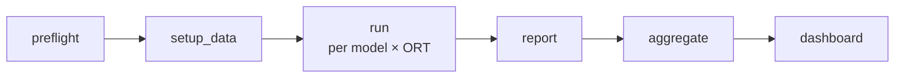

<div align="center">

# DX-Benchmark (Beta)

**Reproducible YOLO26 performance on DEEPX NPUs — one procedure, any Host PC + NPU combination.**

[](https://deepx-ai.github.io/dx-all-suite/dx-benchmark/)


</div>

DX-Benchmark runs the same standardized measurement on every Host PC + DEEPX NPU combination, so
results compare directly across hardware and across dx-all-suite releases. It measures two tiers:

- **Model-Level** (`dxrun`) — **Latency** (single-core, sync) and **Throughput** (multi-core, async)
- **E2E Pipeline** (DX-STREAM) — **Single-Stream** FPS and **Multi-Stream** channel capacity (every channel ≥ 30 fps)

Every run compares ONNX-Runtime ON and OFF, cools the NPU to a controlled temperature before each
measurement, and flags thermal throttling instead of hiding it.

## What You Need

| | |
|---|---|
| **OS** | Linux (x86_64 or arm64) |
| **NPU** | DX-M1, DX-M1M or DX-H1 Quattro |
| **Python** | 3.9+ — standard library only, no pip packages |
| **DEEPX runtime** | DX-RT and DX-STREAM from `dx-runtime/install.sh --all`: `dxrun` / `run_model`, `dxrt-cli`, `gst-launch-1.0`, `gst-inspect-1.0` on `PATH`, and the DX-STREAM plugin and postprocess libraries under `/usr/local/share/gstdxstream/lib/` |
| **System tools** | GNU `time`, `jq`, `ffmpeg` (provides `ffprobe`), `curl`, `tar` — installed by `sudo ./setup_host.sh` on apt systems (e.g. `dnf install time jq ffmpeg curl tar` elsewhere) |
| **Network** | Access to `https://sdk.deepx.ai` for models and videos |

`./run.sh preflight` checks all of the above.

> **For comparable numbers**, keep cooling, power, background load and CPU governor the same across the
> runs you compare. No specific governor is required — the fingerprint records what your host actually
> uses, so every run is traceable.

## Quick Start

Run on the target with a DEEPX NPU:

```bash
cd dx-all-suite/dx-benchmark

./run.sh preflight          # check tools and print an environment fingerprint
./setup_data.sh             # one-time: download models and videos (no sudo)
sudo ./setup_host.sh        # one-time: system packages, passwordless dxrt restart, journal access
./run.sh run                # full suite: model-level + E2E + multi-stream

./run.sh dashboard results  # build the dashboard, then view it
cd results/dashboard && python3 -m http.server 8899   # open http://localhost:8899/
```

A full run takes a while. Preview what will run with `./run.sh dry-run`, or narrow it with
`--sizes n,s` and `--task object_detection`.

## Results

YOLO26 (sizes n–x, five tasks) is measured on x86_64 and Arm hosts with DEEPX NPU cards and modules.
The results come in three forms, from conclusions to raw data:

| | What it gives you |
|---|---|
| **[Dashboard](https://deepx-ai.github.io/dx-all-suite/dx-benchmark/)** | Every measured value in charts and tables, compared across environments and dx-all-suite releases |
| **Analysis** — [English](docs/ANALYSIS_EN.md) · [한국어](docs/ANALYSIS_KOR.md) | Key findings, which configuration fits a target channel count, and the host-side limits (video decoding, CPU, PCIe, thermal) behind each number |
| **Per-run reports** — `results/<hw_id>/<run_id>/REPORT.md` | Every value of one run, with its environment and test conditions |

## Supported Tasks

| Task | Model-Level | E2E Pipeline | Multi-Stream |
|------|:-----------:|:------------:|:------------:|
| Object Detection | O | O | O |
| Pose Estimation | O | O | O |
| Segmentation | O | O | O |
| Oriented BBox (OBB) | O | O | O |
| Classification | O | O | — |

OBB uses 1024×1024 input, Classification 224×224 (keep-ratio=false), all others 640×640.
Classification has no Multi-Stream — a 224×224 classifier is not representative of multi-stream video analytics.

## Usage

```bash
./run.sh run --family model                     # model | e2e | multi | all
./run.sh run --sizes n,s --model-time 30        # fewer sizes, shorter throughput runs
./run.sh run --resume results/<hw_id>/<run_id>  # continue an interrupted run
./run.sh run --resume results/<hw_id>/<run_id> --retry-failed   # rerun only failed conditions
./run.sh report results/<hw_id>/<run_id>        # regenerate REPORT.md
./run.sh aggregate results                      # merge all runs into dataset.json
./run.sh --version                              # tool version
```

The dashboard is plain HTML/CSS/JS with no CDN, so it works offline, and the published copy is rebuilt from
`results/dashboard/` on each dx-all-suite release. Its tabs: **E2E FPS Overview**, **Full Metrics**,
**Detailed Data** and **Version Trend**. `./run.sh` wraps `python3 -m benchmark`, so either form works.

<details>
<summary><b>Version Trend Tracking</b> — compare dx-all-suite releases on the same hardware</summary>


Compare benchmark results before and after dx-all-suite releases using the same HW_ID.

```bash
# (1) Run benchmark on each environment
./run.sh run

# (2) Bump dx-all-suite version (release.ver or --dx-all-suite-version), run again on the same HW
./run.sh run

# (3) Generate dashboard from nested results root → check Version Trend tab
./run.sh dashboard results
```

Results always follow the `results/{hw_id}/{run_id}/` structure. HW_ID is automatically
computed from the `environment.json` fingerprint during `run`.

- With `--product-name`: `{product_name}_{hw_config}` (e.g., `DX-AIPlayer-N97_M1`)
- Without: `{hostname}_{hw_config}` (e.g., `RPi5B_M1`)

The version is captured per run, resolved in this order:

1. `--dx-all-suite-version vX.Y.Z` passed to `run` (explicit — always wins), else
2. in-suite: auto-read from the **suite-root** `release.ver` (above the `dx-benchmark/`
   folder; dx-benchmark's own `release.ver` is skipped), else
3. neither available → a `[WARN]` is printed and the run is recorded (and bucketed) as `unknown`.

> There is **no interactive prompt** — an unattended run never blocks. On a machine without
> `release.ver`, pass `--dx-all-suite-version` explicitly for an accurate Version Trend.

</details>

<details>
<summary><b>CLI Options</b></summary>


#### `run` / `dry-run` Common Options

| Option | Default | Description |
|--------|---------|-------------|
| `--task` | `all` | Task type (`all`, `object_detection`, `pose_estimation`, `segmentation`, `oriented_bbox`, `classification`) |
| `--sizes` | `n,s,m,l,x` | Model sizes to measure (comma-separated) |
| `--family` | `all` | Benchmark family: `model`, `e2e`, `multi`, `all` |
| `--model-time` | 30 | Model-level throughput measurement duration (seconds, `dxrun -t`). Latency uses fixed 300 loops (`-l`) |
| `--warmup` | 1 | Warmup run count |
| `--runs` | — | Override all repetition counts to the same value. Defaults: latency=1, throughput=3, e2e=3 |
| `--fps-threshold` | 30 | Per-channel minimum FPS threshold for multi-stream |
| `--video` | Auto per task | Override input video path (applied to all tasks) |
| `--output` | `results/` | Output root directory. Actual output: `<output>/<hw_id>/<run_id>/` |
| `--resume` | — | Resume from an existing result directory |
| `--retry-failed` | — | With `--resume`, rerun only entries not in `ok`/`partial` status |
| `--product-name` | — | Product name. Used in HW_ID instead of hostname (e.g., `DX-AIPlayer-N97`) |
| `--dx-all-suite-version VER` | Auto (`release.ver`) | dx-all-suite release version for the Version Trend axis (e.g. `vX.Y.Z`) |

#### Subcommands

| Command | Description |
|---------|-------------|
| `--version` | Print the dx-benchmark tool version and exit |
| `preflight` | Check tool availability + print environment fingerprint |
| `dry-run` | Preview benchmark matrix (no execution) |
| `run` | Execute benchmarks |
| `report <result_dir>` | Regenerate Markdown report from existing results |
| `aggregate <results_root> [--output PATH]` | Aggregate results into dataset.json |
| `dashboard <results_root> [--output DIR]` | Generate static HTML dashboard |

</details>

<details>
<summary><b>Directory and Output Structure</b></summary>


```
dx-benchmark/
├── run.sh          # launcher
├── setup_data.sh   # data setup: download models + videos (no sudo)
├── setup_host.sh   # one-time host provisioning (sudo): system deps + dxrt sudoers + journal
├── docs/           # ANALYSIS_EN.md, ANALYSIS_KOR.md
├── benchmark/      # python package (python3 -m benchmark)
└── results/
    ├── <hw_id>/<run_id>/   # tracked: *_results.json + environment.json + REPORT.md
    │                       # git-ignored (local-only): raw/, incidents/, *.csv
    └── dashboard/          # tracked build artifacts (index.html/app.js/styles.css/dataset.json)
```

Per-run output:

```
results/{hw_id}/{run_id}/
├── environment.json              # tracked — fingerprint + timing + timing_history
├── model_results.json            # tracked — model-level results (throughput + latency)
├── pipeline_results.json         # tracked — E2E single-stream results
├── multi_stream_results.json     # tracked — multi-stream boundary search results
├── REPORT.md                     # tracked — comprehensive Markdown report
├── *_results.csv                 # git-ignored — CSV mirror of the JSON (identical columns)
├── raw/                          # git-ignored — raw logs (.log + .npu.log + profiler.json)
└── incidents/                    # git-ignored — timeout diagnostic snapshots (when applicable)
```

> **What ships in git:** per-run `*_results.json` + `environment.json` + `REPORT.md`, and the
> built dashboard. `raw/`, `incidents/`, and `*.csv` mirrors are git-ignored (regenerated
> locally). JSON is the lossless source of truth — every command reads it, so a fresh clone
> rebuilds everything.

</details>

## How It Works



For every model × ORT mode, `run` follows a thermal-normalized sequence —
**cooldown → latency (cold) → throughput → cooldown → E2E → multi-stream**. Latency is measured
cold, each throughput run starts from the same cooled temperature, and E2E and multi-stream measure
their own sustained load. Hung processes are recovered automatically (graceful shutdown → retry →
NPU service restart), and the run aborts early if the NPU stops responding.

Measurement parameters, execution order and recovery strategy → [Methodology](docs/METHODOLOGY.md)

## Development & Testing

No third-party runtime dependencies (standard library only). The test suite uses `pytest`
(a dev-only dependency):

```bash
cd /path/to/dx-benchmark
pip install pytest          # dev-only; not needed to run benchmarks
python3 -m pytest tests/
```

The repo-root `conftest.py` is intentionally empty — its presence sets the pytest
`rootdir` and puts the package root on `sys.path`, so `import benchmark` resolves without
any install or `PYTHONPATH` tweaks.

**Analysis-document gate.** `tests/test_analysis_doc_values.py` recomputes every number
printed in `docs/ANALYSIS_EN.md` / `docs/ANALYSIS_KOR.md` from the committed
`results/<env>/<run>/*_results.json` and fails if the document disagrees — tables, derived
statistics (coefficient of variation, ORT gain ranges, throttle spreads) and the prose
figures alike. Run it after adding measurement data or editing the analysis documents:

```bash
python3 -m pytest tests/test_analysis_doc_values.py -v
```

It resolves runs the same way the dashboard does (highest `dx_all_suite_version` present =
current release, next-highest = trend baseline), and skips itself when fewer than two
versions are committed.

## Documentation & Support

- Results and analysis: [Dashboard](https://deepx-ai.github.io/dx-all-suite/dx-benchmark/) · [Analysis](docs/ANALYSIS_EN.md) · [DX-AllSuite](../README.md)
- For technical questions, please ask in the DEEPX Developer Community: https://community.deepx.ai/c/support/5

## License

See [`LICENSE`](LICENSE). Provided for use with DEEPX NPU products.

Copyright © DEEPX Co., Ltd.
