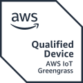

<div align="center">

# DX-Edge

**Take a trained model to DEEPX NPUs in the field — compiled, deployed and managed through AWS.**

<picture><source media="(prefers-color-scheme: dark)" srcset="docs/source/img/badges/available-in-aws-marketplace-dark.png"></picture>
<picture><source media="(prefers-color-scheme: dark)" srcset="docs/source/img/badges/powered-by-aws-dark.png"></picture>
<picture><source media="(prefers-color-scheme: dark)" srcset="docs/source/img/badges/aws-partner-dark.png"></picture>

</div>

DX-Edge covers the three things between a trained ONNX model and a working edge deployment —
compiling the model for the NPU, provisioning the runtime on the device, and qualified hardware to run
it on — using AWS services you already operate.

## Which Track Do I Need?

| If you want to… | Use |
|---|---|
| Compile models **and** deploy the runtime to devices over the air | **DEEPX Greengrass Solution** — one CloudFormation stack does both |
| Only compile ONNX → `.dxnn` on AWS, and manage device runtimes yourself | **DEEPX Compiler Solution** |
| Set up qualified hardware as an AWS IoT Greengrass device | **DX-AIPlayer N97** or **DX-M1 Raspberry Pi 5 Dev Kit** guide |

## Tracks

| Track | What it does | AWS delivery | Guide |
| :--- | :--- | :--- | :--- |
| **DEEPX Greengrass Solution** | Compiles ONNX models to `.dxnn` in the cloud, then installs the NPU driver, firmware, `dx_rt` and `dx_stream` on edge devices over the air (zero-touch provisioning) via AWS IoT Greengrass V2 | CloudFormation stack on [AWS Marketplace](https://aws.amazon.com/marketplace/pp/prodview-732s46qfzuh34) | [Guide](docs/source/01_DEEPX_Greengrass_Solution.md) |
| **DEEPX Compiler Solution** | Compiles ONNX models to `.dxnn` on AWS — interactively on an EC2 instance, or through an event-driven S3 → Lambda → Step Functions pipeline | AMI on [AWS Marketplace](https://aws.amazon.com/marketplace/pp/prodview-ev6ed5omu4ulo) | [Guide](docs/source/02_DEEPX_Compiler_Solution.md) |
| **AWS HW Path — DX-AIPlayer N97** | Compact edge AI system (Intel® N97 + DX-M1, Ubuntu 24.04 LTS) set up as a Greengrass core device, from unboxing to first component deployment | Hardware | [Getting Started](docs/source/03_Getting_Started_Guide_for_AWS_IoT_Greengrass_DX-AIPlayer-N97.md) |
| **AWS HW Path — DX-M1 Raspberry Pi 5 Dev Kit** | Raspberry Pi 5 + DX-M1 on an M.2 HAT (Raspberry Pi OS 64-bit) set up as a Greengrass core device, from assembly to first component deployment | Hardware | [Getting Started](docs/source/04_Getting_Started_Guide_for_AWS_IoT_Greengrass_DX-M1-RPi5-DevKit.md) |

You pay for the AWS resources you use; software pricing and subscription terms are on each AWS Marketplace listing.

## How It Works

```
   ONNX model                DEEPX Compiler Solution              .dxnn artifact
       │                  (DEEPX Compiler Solution AMI)                  │
       └──────────────────────────────►─────────────────────────────────┘
                                                                        │
   Edge device                DEEPX Greengrass Solution                 ▼
   (DX-AIPlayer N97,   ──►    driver · firmware · dx_rt · dx_stream  ──► inference
    Raspberry Pi 5,           installed over the air (ZTP) via
    x86_64 Ubuntu host)       AWS IoT Greengrass V2
```

**AWS services used:** CloudFormation · S3 · Lambda · Step Functions · EC2 · Systems Manager · CloudWatch Logs · IoT Core · IoT Greengrass V2

## Validated Hardware

<p align="right">
<picture><source media="(prefers-color-scheme: dark)" srcset="docs/source/img/badges/aws-qualified-device-dark.png"></picture>
<picture><source media="(prefers-color-scheme: dark)" srcset="docs/source/img/badges/aws-qualified-software-dark.png"></picture>
</p>

| Hardware | Specification |
| :--- | :--- |
| **DEEPX DX-M1** | M.2 2280 AI accelerator, 25 TOPS INT8, 4 GB LPDDR5, max 5 W; fits an arm64 host such as Raspberry Pi 5 or an x86_64 industrial PC |
| **DX-AIPlayer N97** | Intel® Processor N97 (x86_64) + DX-M1, 8 GB LPDDR5 / 64 GB eMMC, 2× GbE, Ubuntu 24.04 LTS, 95 × 95 × 55 mm |
| **DX-M1 Edge AI Development Kit with Raspberry Pi 5** | Raspberry Pi 5 8 GB (aarch64) + DX-M1 over PCIe Gen 3 (M.2 HAT), microSD, 1× GbE, Raspberry Pi OS (64-bit, Debian 13 "Trixie") |

The DX-AIPlayer N97 and the Raspberry Pi 5 Dev Kit are **AWS Qualified Devices for AWS IoT Greengrass**,
supporting both the classic Greengrass nucleus and Greengrass nucleus lite. Their Getting Started Guides
follow the AWS Device Qualification Program template, with every mandatory section in the template's order.

## Documentation & Support

- DEEPX documentation: [developer.deepx.ai/tech-docs](https://developer.deepx.ai/tech-docs/) · [DX-AllSuite](../README.md)
- For technical questions, please ask in the DEEPX Developer Community: https://community.deepx.ai/c/support/5

Copyright © DEEPX Co., Ltd.
