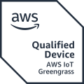
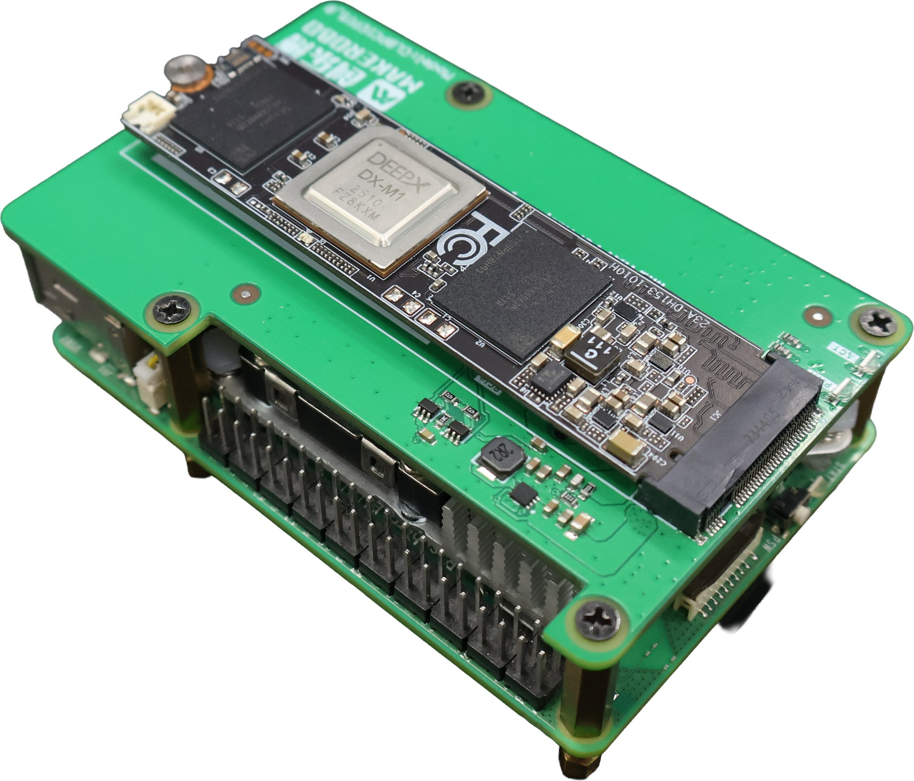
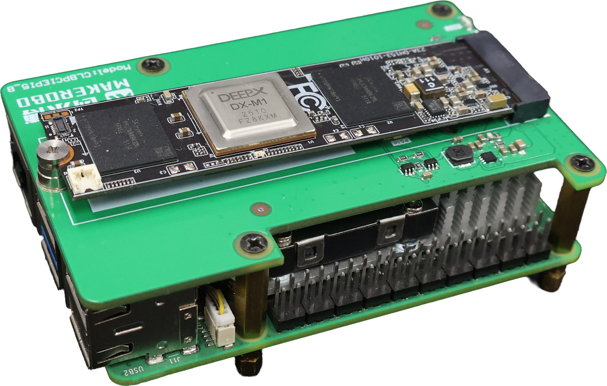
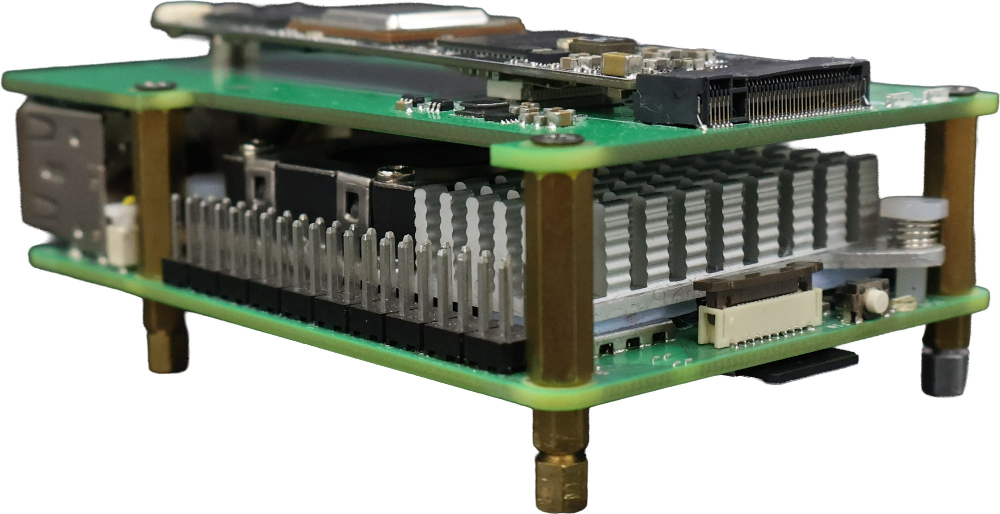

# DX-M1 Edge AI Development Kit with Raspberry Pi 5 — Getting Started Guide for AWS IoT Greengrass

This guide walks you through setting up AWS IoT Greengrass V2 on the DEEPX DX-M1 Edge AI Development Kit with Raspberry Pi 5 and verifying that the device communicates with AWS IoT services, from assembly to deploying your first Greengrass component.

## Quick Start Path

Follow these five phases in order:

1. Understand the DX-M1 Raspberry Pi 5 kit and its hardware.
2. Assemble the kit, flash Raspberry Pi OS, enable PCIe Gen 3, and prepare the AWS account and Greengrass prerequisites.
3. Install and register AWS IoT Greengrass.
4. Create and deploy a Hello World component.
5. Debug the setup or continue with DX-Edge runtime deployment.

## 1. Document information

### 1.1 Document revision history

| Revision | Date | Description |
|---|---|---|
| 1.0 | 2026-08-20 | Initial release |

### 1.2 Applicable operating systems for this guide

This guide applies to the DEEPX DX-M1 Edge AI Development Kit with a Raspberry Pi 5 (aarch64) host and a Raspberry Pi OS (64-bit) operating system running AWS IoT Greengrass.

| Role | Operating system |
|---|---|
| Device (DX-M1 Kit / Raspberry Pi 5) | Raspberry Pi OS (64-bit, Debian 13 "Trixie", aarch64) |
| Host computer | Any OS with a web browser and an SSH client (Windows 10/11, macOS, or Linux) |

## Part I. Understand the device

## 2. Overview

<picture>
  <source media="(prefers-color-scheme: dark)" srcset="img/badges/aws-qualified-device-dark.png">
  
</picture>

The DEEPX DX-M1 Edge AI Development Kit with Raspberry Pi 5 pairs a Raspberry Pi 5 (8 GB) host with the DEEPX DX-M1 AI accelerator (M.2 module) on an M.2 base HAT, delivering up to 25 TOPS of neural inference at 1–5 W of accelerator power. It is intended for developers building and evaluating edge AI vision projects that combine local NPU-accelerated inference with cloud connectivity through AWS IoT Greengrass.

Running Raspberry Pi OS (64-bit, Debian 13 "Trixie", aarch64), the kit hosts the AWS IoT Greengrass Core software (classic nucleus), enabling local execution of Greengrass components, Docker application components, messaging, and secure communication with the AWS Cloud.



## 3. Hardware description

### 3.1 Datasheet

- DEEPX DX-M1 product information: https://deepx.ai
- Kit product page (purchase): https://www.eleparts.co.kr/goods/view?no=18574428

Key specifications:

| Item | Specification |
|---|---|
| Host board | Raspberry Pi 5 (Broadcom BCM2712, quad-core Arm Cortex-A76 @ 2.4 GHz, aarch64) |
| AI Accelerator | DEEPX DX-M1 (M.2 2280 M-Key), 25 TOPS INT8, 4 GB LPDDR5 (5600 MT/s), 1–5 W |
| Memory | 8 GB LPDDR4X (host) |
| Storage | microSD card (included) |
| Accelerator interface | PCIe Gen 3 via MAKEROBO M.2 HAT (DX-M1 supports Gen 1/2/3, x1/x2/x4) |
| Networking | 1x GbE LAN (RJ45) |
| USB | 2x USB 3.0, 2x USB 2.0 |
| Display | 2x micro-HDMI |
| OS | Raspberry Pi OS (64-bit, Debian 13 "Trixie") |

### 3.2 Standard kit contents

- 1x Raspberry Pi 5 (8 GB RAM)
- 1x DEEPX DX-M1 AI accelerator (M.2 2280 M-Key module)
- 1x MAKEROBO M.2 HAT for Raspberry Pi 5 (PCIe-to-M.2 carrier, model CLBPCIEPI5_9), with standoffs, screws, and PCIe FPC cable
- 1x Active cooler for the Raspberry Pi 5
- 1x USB power adapter
- 1x microSD card (for OS and project storage) with USB card reader
- Reference materials: DX-AllSuite guide (GitHub), assembly guide (PDF), Raspberry Pi 5 user guide (PDF)

### 3.3 User-provided items

- Ethernet cable for internet connectivity
- USB keyboard/mouse and a monitor with micro-HDMI input for initial setup (or use SSH over the network)
- A host computer for remote access

The kit already includes the microSD card, active cooler, USB power adapter, and the M.2 HAT with mounting hardware, so no additional accelerator carrier, storage, cooling, or power accessory is required.

### 3.4 Third-party purchasable items

None. All core components are included in the kit.

## Part II. Prepare the environment

## 4. Development environment

### 4.1 Tools installation (IDEs, Toolchains, SDKs)

No device-specific IDE or toolchain is required to run AWS IoT Greengrass on the kit. You will need:

- The AWS Command Line Interface (AWS CLI) on the device or host, if you prefer command-line setup. See [Installing the AWS CLI](https://docs.aws.amazon.com/cli/latest/userguide/getting-started-install.html).
- (Optional) To develop AI-accelerated Greengrass components using the DX-M1 accelerator, install the DEEPX DX-RT runtime and DXNN® SDK. See the [DEEPX Technical Documentation](https://developer.deepx.ai/tech-docs).

## 5. Device hardware setup

### 5.1 Assemble the kit

1. Attach the M.2 HAT to the Raspberry Pi 5 using the included standoffs and connect the PCIe FPC cable, following the assembly guide included with the kit.
2. Install the DEEPX DX-M1 M.2 module into the HAT's M.2 slot and secure it with the provided screw.
3. Attach the included active cooler to the Raspberry Pi 5.
4. Insert the microSD card prepared with Raspberry Pi OS (see [5.2](#52-flash-raspberry-pi-os)).
5. Connect an Ethernet cable to the Raspberry Pi 5 LAN port.
6. (Initial setup) Connect a monitor via micro-HDMI and a USB keyboard, or plan to use SSH.
7. Connect the included USB power adapter to boot.

**Top view** — DX-M1 module on the M.2 base HAT over the Raspberry Pi 5:



**Side view** — layered stack; Raspberry Pi 5 I/O accessible along the lower edge:



### 5.2 Flash Raspberry Pi OS

Using Raspberry Pi Imager on your host computer, flash **Raspberry Pi OS (64-bit)** to the included microSD card (using the bundled card reader). Create your user account during imaging or on first boot, and enable SSH if you plan to work remotely.

Verify internet connectivity on the device:

```bash
ping -c 3 amazon.com
```

### 5.3 Enable PCIe Gen 3

The DX-M1 uses the Raspberry Pi 5 PCIe interface. Enable PCIe Gen 3 for full bandwidth:

```bash
sudo raspi-config
# Advanced Options -> PCIe Speed -> Yes (enable PCIe Gen 3) -> Finish -> reboot
```

After reboot, confirm the accelerator is detected on the PCIe bus:

```bash
lspci | grep -i deepx
# Expected: 0001:01:00.0 Processing accelerators: DEEPX Co., Ltd. DX_M1 (rev 01)
```

### 5.4 Install the DX-M1 driver and runtime

Install the DEEPX NPU driver (DKMS) and the DX-RT runtime following the DX-AllSuite [Setting Up Environment](../../../docs/source/02_Setting_Up_Environment.md) guide and the [DEEPX Technical Documentation](https://developer.deepx.ai/tech-docs). After installation, verify:

```bash
lsmod | grep -E 'dxrt|dx_'        # expect dxrt_driver and dx_dma loaded
ls /dev/dxrt0                     # expect the device node to exist
dxrt-cli --version                # expect DX-RT runtime version to print
```

> **Note**
>
> The DX-M1 driver and runtime are required to run AI inference on the
> accelerator. They are independent of AWS IoT Greengrass qualification, which
> validates the Greengrass Core software path. Alternatively, skip this step and
> let the [DEEPX Greengrass Solution](01_DEEPX_Greengrass_Solution.md) install
> them over the air after Greengrass registration (see [Next steps](#next-steps--deploying-the-deepx-runtime-with-dx-edge)).

### 5.5 Install Greengrass prerequisites

AWS IoT Greengrass Core software requires a Java Runtime Environment (Java 8 or greater):

```bash
sudo apt update
sudo apt install -y default-jre curl unzip
java -version
```

(Optional) To deploy Docker application components, install Docker Engine and confirm the classic image store:

```bash
docker --version
docker info | grep -i 'storage driver'   # expect: overlay2
```

## 6. AWS IoT Greengrass overview

To learn more about AWS IoT Greengrass, see [How AWS IoT Greengrass works](https://docs.aws.amazon.com/greengrass/v2/developerguide/how-it-works.html) and [What's new in AWS IoT Greengrass Version 2](https://docs.aws.amazon.com/greengrass/v2/developerguide/greengrass-v2-whats-new.html).

## 7. Greengrass prerequisites

Refer to the online documentation detailing the prerequisites needed for AWS IoT Greengrass. Follow the instructions in the following sections of [Tutorial: Getting started with AWS IoT Greengrass V2](https://docs.aws.amazon.com/greengrass/v2/developerguide/getting-started.html):

- [Step 1: Set up an AWS account](https://docs.aws.amazon.com/greengrass/v2/developerguide/getting-started-set-up-aws-account.html)
- [Step 2: Set up your environment](https://docs.aws.amazon.com/greengrass/v2/developerguide/getting-started-prerequisites.html)

## Part III. Install and register Greengrass

## 8. AWS IoT Greengrass installation

Follow the online guide to [Install the AWS IoT Greengrass Core software with automatic provisioning](https://docs.aws.amazon.com/greengrass/v2/developerguide/quick-installation.html). The steps below summarize the process on the kit.

1. Provide AWS credentials to the device. For development environments, you can use long-term credentials from an IAM user:

```bash
export AWS_ACCESS_KEY_ID=<the access key id for your user>
export AWS_SECRET_ACCESS_KEY=<the secret access key for your user>
```

> **Security note**
>
> Use long-term IAM user credentials only for development and testing. For
> production environments, use an IAM role or temporary credentials instead,
> and follow your organization's credential management policy.

2. Download the AWS IoT Greengrass Core software:

```bash
cd ~
curl -s https://d2s8p88vqu9w66.cloudfront.net/releases/greengrass-nucleus-latest.zip -o greengrass-nucleus-latest.zip
unzip greengrass-nucleus-latest.zip -d GreengrassInstaller
```

3. Install the AWS IoT Greengrass Core software (replace the region, thing name, and group name as needed):

```bash
sudo -E java -Droot="/greengrass/v2" -Dlog.store=FILE \
  -jar ./GreengrassInstaller/lib/Greengrass.jar \
  --aws-region ap-northeast-2 \
  --thing-name DX-M1-RPI5-Core \
  --thing-group-name DXGreengrassGroup \
  --thing-policy-name GreengrassV2IoTThingPolicy \
  --tes-role-name GreengrassV2TokenExchangeRole \
  --tes-role-alias-name GreengrassCoreTokenExchangeRoleAlias \
  --component-default-user ggc_user:ggc_group \
  --provision true \
  --setup-system-service true
```

4. Verify that the Greengrass Core software is running:

```bash
sudo systemctl status greengrass.service
```

You can also verify in the AWS IoT console under **Greengrass devices > Core devices** that the device status is **Healthy**.

## Part IV. Deploy the first component

## 9. "Hello World" component

### 9.1 Create the component on your edge device

Follow the instructions online under [Develop and test a component on your device](https://docs.aws.amazon.com/greengrass/v2/developerguide/getting-started.html#create-first-component) to create a simple Hello World component locally on the kit and verify its output:

```bash
sudo tail -f /greengrass/v2/logs/com.example.HelloWorld.log
```

### 9.2 Upload the "Hello World" component

Follow the instructions online at [Create your component in the AWS IoT Greengrass service](https://docs.aws.amazon.com/greengrass/v2/developerguide/getting-started.html#upload-first-component) to upload your component to the cloud, where it can be deployed to other devices as needed.

### 9.3 Deploy your component

Follow the instructions online at [Deploy your component](https://docs.aws.amazon.com/greengrass/v2/developerguide/getting-started.html#deploy-first-component) to deploy the component from the AWS IoT console and verify that it is running on the device.

## Part V. Operate and troubleshoot

## 10. Debugging

- Greengrass Core logs are located at `/greengrass/v2/logs/greengrass.log`; component logs at `/greengrass/v2/logs/<component-name>.log`.
- To change the nucleus log level, see [Log levels](https://docs.aws.amazon.com/greengrass/v2/developerguide/monitor-logs.html).
- To view system boot and service messages: `journalctl -u greengrass.service -f`.

## 11. Troubleshooting

| Symptom | Resolution |
|---|---|
| Installer fails with `java: command not found` | Install Java: `sudo apt install -y default-jre`, then re-run the installer |
| `lspci` does not show the DX_M1 | Ensure PCIe Gen 3 is enabled in `raspi-config`, the M.2 module is fully seated, and the HAT FPC cable is connected; reboot |
| `dxrt-cli` not found | Install the DX-M1 driver and DX-RT runtime (see [5.4](#54-install-the-dx-m1-driver-and-runtime)); confirm `dxrt_driver` is loaded with `lsmod` |
| Device does not appear in AWS IoT console | Check internet connectivity and that outbound TCP 443 to AWS endpoints is allowed by your firewall; verify the AWS region matches the console region |
| `greengrass.service` fails to start | Check `/greengrass/v2/logs/greengrass.log`; ensure the installation used `sudo` |
| Docker component deployment fails | Confirm Docker Engine is installed and `docker info` reports the `overlay2` storage driver |

For more information, refer to the online documentation [Troubleshooting AWS IoT Greengrass V2](https://docs.aws.amazon.com/greengrass/v2/developerguide/troubleshooting.html).

For device-specific support, contact DEEPX at tech_support@deepx.ai or visit https://deepx.ai/contact-us/technical-support/

## Next steps — deploying the DEEPX runtime with DX-Edge

Once the device is registered with AWS IoT Core and included in a Thing Group, the DEEPX NPU driver, firmware, `dx_rt` runtime, and `dx_stream` media pipeline can be installed over the air, with no on-site work, using the **DEEPX Greengrass Solution** available on AWS Marketplace. See [DEEPX Greengrass Solution](01_DEEPX_Greengrass_Solution.md).

To compile your own ONNX models into the DEEPX NPU execution format on AWS, see [DEEPX Compiler Solution](02_DEEPX_Compiler_Solution.md).
